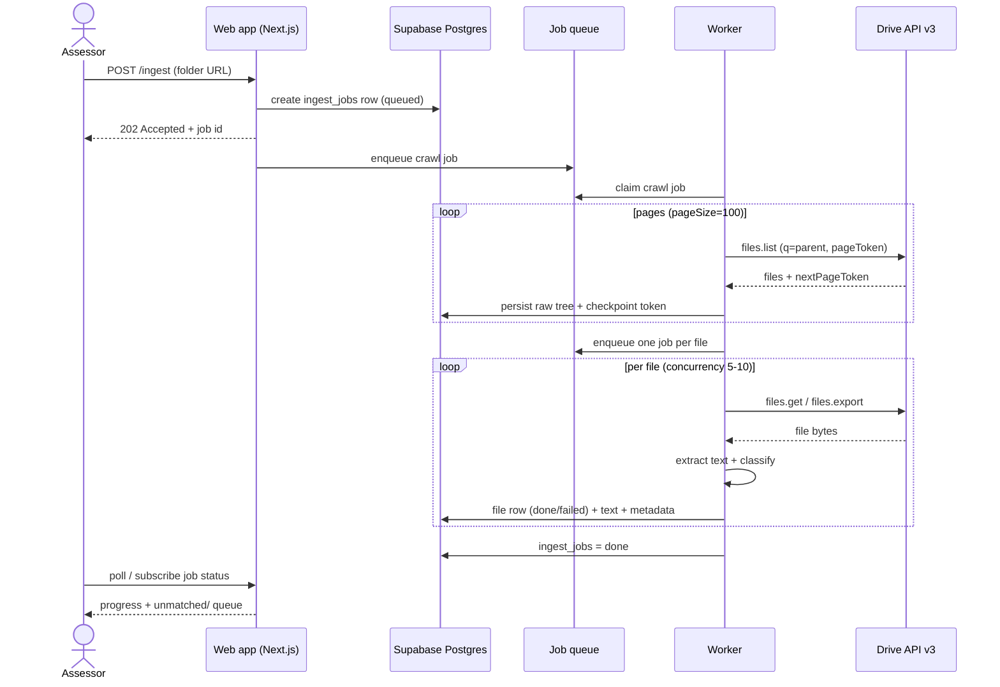
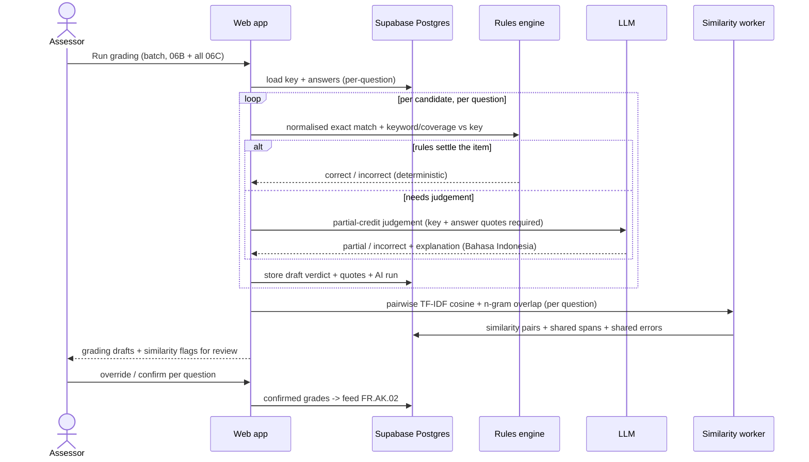
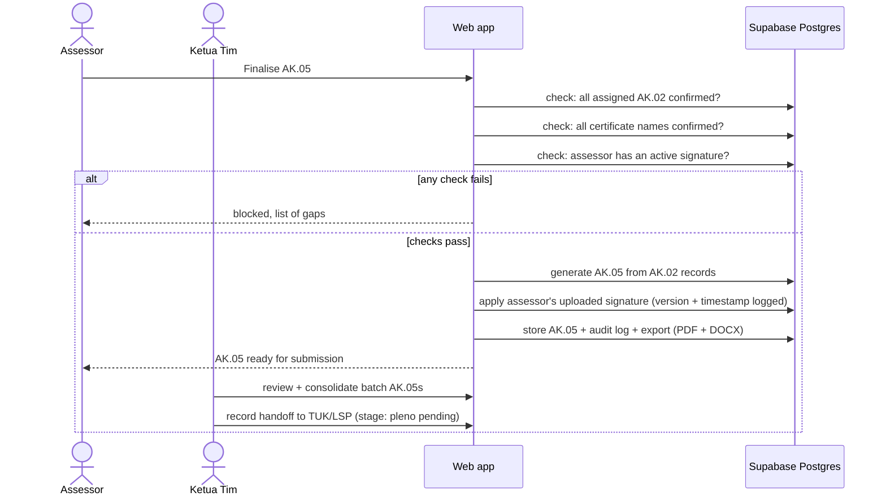
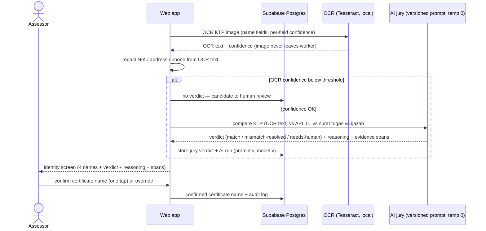

# 02 — Product Requirements Document (PRD): AsesorKompetensi

| Field | Value |
|---|---|
| Version | v1.4 — 2026-11-18 (see §15 changelog) |
| Product | AsesorKompetensi — assessor workbench for LSP/BNSP competency certification |
| Repo | https://github.com/danste-kun/asesorkompetensi — PUBLIC, 517 files, ~692 MB (10 commits, 17 Nov 2026); source of blank forms, never a data store |
| Depends on | `01-project-overview.md`, `research/bnsp-forms-brief.md`, `research/tech-stack-brief.md`, `research/drive-inventory-2026-11-17.md`, `research/form-blanks-extracted.md`, `research/v1.1-prep-decisions.md` |

---

## 1. Problem statement

An LSP assessor running a certification batch (for example 23 Ahli K3 Umum candidates on one day, split across 2 assessors) currently works from public Google Drive folders and a spreadsheet. The folders are messy and unpredictable — naming variants, duplicate markers, generic image names, a candidate list stored in a single spreadsheet cell. The assessor must:

- verify each candidate's document completeness (APL.01, APL.02, KTP, ijazah, pas foto, CV, sertifikat pelatihan, portofolio) by hand;
- match the name on the surat tugas against the KTP and APL.01 so the certificate is not misspelled — in v1.2 an AI jury adjudicates this: local OCR reads the KTP image and the jury compares the other sources against the KTP (OCR text), issuing a verdict the assessor confirms (decision D10); in v1.3 the rule is decided (D6): the KTP is the authority — the certificate name is the KTP name verbatim, word for word (e.g. surat tugas "Declan Rice P." vs KTP "Declan Rice Pangabean" → final name "Declan Rice Pangabean");
- sign the documents that require an assessor signature (AK.05, AK.02, AK.01, AK.06, AK.07, FR.IA.04B, Berita Acara) by printing, hand-signing, and rescanning — in v1.2 the assessor uploads a signature once and the system applies it at sign-off (decision D11);
- read every DIT paper (FR.IA.04A) and every written-test answer (FR.IA.06C), grade them against the master key (FR.IA.06B), and detect copy-paste between candidates — by eye, at a scale where pairwise comparison is infeasible (23 candidates = 253 pairs; 100 candidates = 4,950 pairs);
- produce the per-candidate decision (FR.AK.02) and the per-assessor batch report (FR.AK.05) from scattered notes, with no audit trail of how any judgement was reached;
- split one flat Drive folder across several assessors when the folder has no per-assessor separation — today the split is reconstructed by hand from the group sheet and the surat tugas;
- use a master key (FR.IA.06B) whose password is held outside the system: each scheme's 06B ships with a PASSWORD Excel file, and the assessor supplies the password at runtime (decision D12). The repo's SKEMA copy of the 06B blank is OLE-encrypted; the working AK3U key copy is a plain docx that opens directly.

Ad-hoc LLM prompting in a chat window helps with single candidates but creates no replayable record, mixes up identities, and cannot enforce the BNSP rules that matter: binary K/BK decisions, VATM evidence quality, professional judgement on essay answers, and human confirmation of certificate names.

**The product solves this by making the batch the unit of work:** ingest once (async, resumable), classify and extract once, analyse with versioned prompts whose outputs are stored, and let the assessor confirm every verdict before the FR.AK.05 pack is generated.

## 2. Goals

| # | Goal | How success is recognised |
|---|---|---|
| G1 | Cut intake + completeness-checking time per batch by ≥ 70% vs the spreadsheet workflow | Timed pilot on a real batch (target: 23-candidate batch ingested and classified in < 1 working day of assessor attention) |
| G2 | Every DIT paper and every 06C answer is compared against every other candidate in the batch | Similarity report covers 100% of pairwise comparisons in scope; no candidate pair is skipped silently |
| G3 | No AI verdict ever reaches a form without assessor confirmation | Audit log shows a human confirm action for 100% of K/BK decisions, grades, and certificate names |
| G4 | FR.AK.05 pack is generated from the system's own records, not re-typed | AK.05 values trace 1:1 to confirmed AK.02 records in the database |
| G5 | The system works for any scheme once configured, not only AK3U | A second scheme (different file set, different question counts, different rules, different prerequisites and requirements) can be onboarded by manifest + seed data only, no code change (D17, v1.4) |
| G6 | Zero NIK/KTP data sent to any LLM | Automated redaction check passes on 100% of LLM call payloads in the audit log |
| G7 | Every certificate name is decided by an AI jury verdict plus a human confirmation — never by eye alone, never auto-finalised | 100% of certificate names carry a jury verdict (match / mismatch-resolved / needs-human, KTP-authoritative per D6) + a logged assessor confirm/override; 0 names auto-finalised |
| G8 | Every generated document that requires an assessor signature carries that assessor's own uploaded signature, applied at sign-off | 100% of signed generated documents carry the correct assessor's signature with a recorded signature + timestamp; 0 documents signed with another assessor's signature; 0 AK.05 submissions without an active signature |

Non-goal: replacing the LSP pleno, BNSP, or the certificate-issuing process. The system stops at the handoff.

## 3. Target users

See Overview §4. Primary user is the **asesor**; secondary users are Ketua Tim Asesor, LSP admin, TUK viewer, and read-only auditor. Candidates are data subjects in v1, not users. All users are Indonesian-speaking; the UI is Bahasa Indonesia; this PRD and the technical docs are in English with Indonesian form names preserved.

**User characteristics (from the real batch):** assessors work on laptops, sometimes on phones in the field; connectivity at a TUK is unreliable; documents are phone photos and scans of variable quality; assessors are domain experts, not power users — the UI must be usable by an assessor who has never used the system, with at most a 30-minute onboarding.

## 4. Feature list — Basic → Advanced

### 4.1 Basic (must-have for the first live batch)

| ID | Feature |
|---|---|
| F-01 | Batch creation: scheme, TUK, date, assessors, groups, route per candidate (structured activity / portfolio / observation) |
| F-02 | Google Drive public-folder ingest (API key, paginated, resumable, per-file jobs) + Google Sheet import (Kelompok Asesi format: merged headers, checkbox columns, single-cell name list). **Upload flow (D13, v1.4):** a scheme and its scheme-level forms are registered once per scheme; per batch the assessor supplies only 1–2 Drive links + the Kelompok Asesi (Drive link or .xlsx); filled per-candidate copies of 04A/04B/09 are ingested from the Drive folder, direct upload is only a fallback |
| F-03 | Document classification (MIME + filename + parent folder + content sniffing) with manual `unmatched/` review queue |
| F-04 | Completeness dashboard per candidate (APL.01/02, KTP, ijazah, pas foto, CV, sertifikat pelatihan, portofolio) with gap + quality flags. **Dashboard look (D20, v1.4):** modern & minimal, glassmorphism, hover lift, gradient accents, dark sidebar + light content, right-hand panel, stat cards with a large value + change arrow, white-and-blue theme, premium, responsive — per paulcodes4's "Dashboard V18", grounded in Moza's screenshot (`workspace/user/media_library/image/Screenshot_2026-11-18_012518.png`) |
| F-05 | Identity matching (AI name jury + KTP OCR): local OCR extracts the REAL name from the KTP image; the AI jury compares APL.01 vs surat tugas vs ijazah against the KTP (OCR text) — the KTP is the authority (D6): the certificate name is the KTP name verbatim, and a mismatch-resolved verdict always proposes the KTP spelling; the assessor confirms (one tap) or overrides; mismatch report |
| F-06 | DIT analysis pipeline (FR.IA.04A + presentation transcript/profile): coverage matrix, gap questions (5 dimensions), 13-question bank (separate artefact from official 04B; count is the scheme's manifest value — 13 is AK3U's value, D17) |
| F-07 | Written-test grading (FR.IA.06B vs 06C): rules-first + LLM partial credit, per-question verdicts (Benar / Sebagian / Salah) with Bahasa Indonesia explanations, side-by-side key vs answer, plus a per-student error summary ("Ringkasan Kesalahan"); no overall % shown as the decision (v1.3 judging shape, D7); per-unit K/BK is the AI's VATM judgement, confirmed or overridden by the assessor (v1.4, D16) |
| F-08 | Cross-candidate similarity: DIT papers + 06C answers, pairwise, per-question, with shared spans and shared-error evidence; flag only — per-scope numeric thresholds with evidence details (D19, v1.4; threshold values UNCONFIRMED); the plagiarism analysis is a separate qualitative report (Bersih / Waspada + reasoning), never a numeric verdict (v1.3, D7) |
| F-09 | Per-candidate decision FR.AK.02 (per-unit K/BK) with assessor confirmation |
| F-10 | FR.AK.05 generation (per assessor, per batch) + export: AK.05 as PDF + DOCX; every other generated document as DOCX only; XLSX only for tabular data extracts (Overview §7, D1–D19; export rule D8) |
| F-11 | Audit log: every AI run (prompt + model version + inputs + raw output), every verdict, every jury verdict, every signature application, every name confirmation, every export |
| F-12 | Auth + roles (assessor, Ketua Tim, LSP admin, TUK viewer, auditor) with RLS; MFA for assessor/admin (see doc 14) |
| F-27 | Multi-assessor folder triage: derive each assessor's file/candidate set from candidate → group → assessor assignment in one flat shared folder; show unassigned files/candidates explicitly (PRD FR-29–FR-31) |
| F-28 | Per-candidate completeness gate on DIT analysis: analysis waits until FR.IA.04A + presentation transcript + profile are complete; missing inputs are listed, never invented (PRD FR-32) |
| F-29 | Assessor-only model answers for the 13-question bank, labelled as model answers, never candidate evidence (PRD FR-33) |
| F-30 | Combined Bahasa Indonesia Markdown report: 06 grading + cross-candidate similarity in one deliverable (PRD FR-34) |
| F-31 | Prompt registry: the two assessor prompts as versioned, per-scheme/per-form templates with approval and replay (PRD FR-35) |
| F-32 | 06B key handling: run-time password entry for the master key (each scheme's 06B ships with a PASSWORD Excel file; the assessor supplies the password at runtime); password never stored or logged (PRD FR-36, D12). The working AK3U key is a plain docx: 13 answers in one prose table + 8 embedded images; the repo's SKEMA copy of the blank is OLE-encrypted — both copies exist |
| F-33 | AI name jury: local KTP OCR + jury verdict (match / mismatch-resolved / needs-human) with reasoning, evidence spans, and OCR confidence — the KTP is the authority (D6): a mismatch-resolved verdict always proposes the KTP spelling; assessor confirms or overrides; every step audit-logged (PRD FR-37) |
| F-34 | Assessor signature: upload once at onboarding/profile (scan/photo PNG or drawn signature), private Storage, versioned; applied at sign-off to documents whose blank carries an assessor signature block (AK.05, AK.02, AK.01, AK.06, AK.07, 04B, Berita Acara); AK.05 submit blocked without an active signature (PRD FR-38) |
| F-35 | Provider settings, BYOK (D18, v1.4): provider + base URL/gateway + model + key as runtime config (Anthropic, OpenAI-compatible, Gemini, OpenRouter / OmniRouter / 9Router, Nvidia NIM, etc.); keys stored locally in the browser, sent per request, never logged or committed; free tiers usable; temperature is a per-prompt config value (grading/jury verdicts stay at temperature 0) |
| F-36 | Scheme registration, once per scheme (D13/D17, v1.4): register a scheme with its file manifest (forms, names/suffixes, required vs optional, instruments), question counts (04B built-in, 06A essay, question-bank default), assessment/decision rules, prerequisites, registration requirements; per batch the assessor supplies only 1–2 Drive links + the Kelompok Asesi |

### 4.2 Intermediate

| ID | Feature |
|---|---|
| F-13 | Portfolio route pipeline: FR.IA.08 desk evaluation → FR.IA.09 interview questions (from IA.08 gaps, not from a presentation) → FR.IA.10 third-party verification |
| F-14 | Observation route: FR.IA.01/02/03 checklists per kelompok pekerjaan |
| F-15 | FR.IA.05 (MC) grading: deterministic key match + per-item K/BK |
| F-16 | FR.IA.04B official presentation-assessment form (per-row Ya/Tdk, KUK coverage, K/BK, signatures) as a fillable in-app form — **verified structure (D14, v1.4):** 4 Kelompok Pekerjaan, 13 built-in questions (one per unit; count is the scheme's manifest value), Ya/Tidak per KUK, binary recommendation; evidence is the DIT task + presentation |
| F-17 | OCR quality ladder: text-layer PDF → Tesseract 5 (`ind+eng`) → multimodal-LLM fallback on flagged pages only, with per-page confidence shown to the assessor; KTP name-field OCR (local Tesseract, with per-field confidence) feeds the AI name jury (F-33) — the KTP image itself never goes to any LLM |
| F-18 | Embeddings + pgvector semantic similarity (paraphrase detection) layered on TF-IDF cosine |
| F-19 | Prompt + model versioning, A/B comparison on 5–10 real candidates, replay of any AI run |
| F-20 | Export to XLSX (completeness, grading, AK.05 tables) — tabular **data** extracts only; generated documents are DOCX (AK.05: PDF + DOCX) per the export rule (D8) |

### 4.3 Advanced (post-v1, only if the LSP asks)

| ID | Feature |
|---|---|
| F-21 | Candidate portal (upload own documents, view own result only) |
| F-22 | Assessor conflict-of-interest check (assessor must not assess relatives/employees — rule text UNCONFIRMED, needs LSP confirmation) |
| F-23 | Appeals (FR.AK.04) and re-assessment (BK units only) workflow with deadlines |
| F-24 | Pleno / certification-decision tracking beyond the handoff (read-only mirror of LSP's decision) |
| F-25 | Cloud OCR (Google Document AI / Azure) if Tesseract quality on real TUK scans is unacceptable — pricing UNCONFIRMED, evaluate only after measurement |
| F-26 | Multi-LSP tenancy, SSO, on-premise / self-hosted Supabase deployment |

## 5. User flows (step-by-step)

### 5.1 Flow A — Set up a batch (LSP admin + assessor, ~30 min)

1. LSP admin registers the scheme **once** (D13/D17, v1.4) — or reuses the AK3U seed: the scheme's file manifest (which forms exist, names/suffixes, required vs optional, instruments), question counts (04B built-in, 06A essay, question-bank default — 13 is AK3U's manifest value, never hard-coded), assessment/decision rules (VATM is AK3U's rule per its scheme document), prerequisites (entry education/experience combinations), registration requirements (evidence list), similarity flag thresholds, retention policy. A scheme is never re-presented at batch time.
2. Admin creates the batch: scheme, TUK, date, venue; assigns assessors and groups; uploads or links the surat tugas. Per batch the assessor supplies only 1–2 Drive links + the Kelompok Asesi (Drive link or .xlsx) — filled per-candidate copies of 04A/04B/09 are ingested from the Drive folder; direct upload is only a fallback (D13).
3. Assessor opens the batch, confirms their assignment and No. Reg, uploads their signature (F-34 — scan/photo PNG or drawn signature; stored versioned in private Storage), and records the MAPA planning reference (FR.MAPA.01/02 prepared outside the system in v1 or attached as files). An assessor with no active signature can work a batch but cannot finalise/submit an AK.05 (FR-38).
4. System creates one candidate record per assessee (from the Sheet import or manual entry) with a pseudonymous candidate ID used in all LLM calls.

### 5.2 Flow B — Ingest Drive folders + Sheet (assessor, async)

1. Assessor pastes the Drive folder URL(s) and the Sheet URL; system validates the URL, extracts folder/sheet IDs, creates an `ingest_jobs` row (`status=queued`), and returns immediately. Filled per-candidate copies of 04A/04B/09 inside the folder are ingested with everything else (D13); direct file upload is only a fallback for files not in the folder.
2. Worker crawls `files.list` page by page (pageSize 100), persists the raw tree (path, file ID, MIME, size, modifiedTime) before downloading anything.
3. Worker creates one job per file (or per batch of 10–20 small files): download → detect type → extract text (see F-17) → classify → link to a candidate (normalised-name fuzzy match) or to `unmatched/`.
4. **Multi-assessor triage (new in v1.1, F-27):** where one flat folder holds several assessors' candidates, the system derives each assessor's file/candidate set from the candidate → group → assessor assignment (Sheet import + surat-tugas parsing, FR-29–FR-31). Files and candidates that cannot be assigned to any assessor are listed as **unassigned** — never silently attached to the assessor who started the crawl. An assessor sees only their own assigned set by default (FR-25); the Ketua Tim / LSP admin sees all sets plus the unassigned list.
5. Assessor watches progress (per-file status: queued / downloading / extracting / done / failed + retry count) and reviews the `unmatched/` queue, mapping files manually. Re-running skips `done` files (idempotency on file ID + modifiedTime).
6. Sheet import runs in parallel: CSV export per tab, merged-header handling, checkbox TRUE/FALSE, single-cell name-list splitting, join to candidates on normalised name. **Sheet import must complete before filename→person assignment is attempted** (the name list is the join key); files ingested before the sheet import are held in `unmatched/` until the join runs.
7. Ingest completes → completeness dashboard populates (F-04).

### 5.3 Flow C — Completeness & identity review (assessor; AI name jury)

1. Assessor opens the completeness dashboard; for each candidate, sees which required documents are present, missing, or quality-flagged (e.g. unsigned `.docx` where a signed scan was expected; pas-foto quality notes).
2. For each candidate the system runs local Tesseract OCR on the KTP image to extract the name fields with per-field confidence (FR-37). The KTP image never leaves the worker and never goes to any LLM; only redacted OCR text (name fields) is passed on.
3. The AI name jury compares the three other sources — APL.01, surat tugas, ijazah — against the KTP (OCR text), which is the authority (D6, decided v1.3): the certificate name is the KTP name verbatim, word for word. The jury issues a verdict: **match** (all sources agree with the KTP), **mismatch-resolved** (differences explained, e.g. title order or a spelling variant — the proposed certificate name is always the KTP spelling; the jury expands abbreviations using the KTP only), or **needs-human** (sources conflict beyond adjudication, the KTP itself is unclear, or OCR confidence is below the configured threshold — in which case no verdict is issued at all). Worked example: surat tugas says "Declan Rice P." but the KTP says "Declan Rice Pangabean" → the final certificate name is "Declan Rice Pangabean". Every verdict carries its reasoning, the evidence spans from each source, and the OCR confidence.
4. Assessor opens the identity screen: the four names side by side with the jury verdict, reasoning, and evidence spans. The assessor confirms the certificate name with one tap, or overrides it with their own value. The jury verdict, the confirmation/override, the actor, and the timestamp are all logged. AK.05 cannot be finalised while any assigned candidate has an unconfirmed certificate name. A jury verdict never silently becomes final — there is no code path from a verdict to a certificate name without an assessor action in between.

### 5.4 Flow D — DIT analysis (structured-activity route, per candidate)

1. Assessor selects a candidate; system shows the linked FR.IA.04A, presentation file/transcript, and profile (CV, portofolio, education, work history). **Completeness gate (FR-32):** if any required input is missing (FR.IA.04A, presentation transcript/recording, or profile), the system lists exactly what is missing and **refuses to run the analysis** — it never invents coverage. The gate is per candidate, matching the RCTFA prompt's "bahan belum lengkap → sebutkan dokumen yang masih dibutuhkan, tunda analisis sampai lengkap".
2. Assessor runs the DIT pipeline (versioned prompt from the registry, the configured provider/model — BYOK, D18). Inputs are redacted (no NIK/KTP images) and delimited as untrusted data.
3. System returns, in Bahasa Indonesia: (a) coverage matrix — every Kelompok Pekerjaan × Titik Fokus with status Terpenuhi / Sebagian / Belum Dibahas + notes; (b) gap-filling questions for every Sebagian/Belum Dibahas item, labelled TS/TMS/CMS/JRES/TrS and tied to the Kelompok Pekerjaan; (c) the 13-question bank, personalised to the candidate's presentation and profile (not the ideal answer, not a shared set) — the count is the scheme's manifest value (13 for AK3U, D17); (d) readiness estimate (coverage %, strengths, critical gaps, follow-up actions); (e) **assessor-only model answers** for the 13-question bank (FR-33) — labelled "model answer for assessor judgement", generated from the presentation + the key/acceptable points, visible only to the assessor, never stored as candidate evidence.
4. Assessor reviews, edits, and confirms each section. The readiness "recommendation" from the AI is stored as a *suggestion*; the assessor's own K/BK judgement is recorded separately and is the only one that counts. "Kompeten Bersyarat" does not exist as a decision value, a status, or a recommendation (D15, v1.4).
5. Assessor conducts the presentation assessment and fills the official FR.IA.04B in-app (per-row Ya/Tdk, KUK coverage, K/BK, signatures) — a separate artefact from the 13-question bank. The 04B form is verified (D14, v1.4): 4 Kelompok Pekerjaan, 13 built-in questions (one per unit; count is the scheme's manifest value), Ya/Tidak per KUK, binary recommendation; its evidence is the DIT task + presentation.

### 5.5 Flow E — Written-test grading (per candidate + cross-candidate)

1. Assessor links the FR.IA.06A (soal), 06B (kunci), and each candidate's 06C (jawaban) — with the per-LSP suffix mapping applied from config. The 06B key password comes from the scheme's PASSWORD Excel file and the assessor supplies it at run time for that grading session (FR-36, D12); the password is never stored or logged. The working AK3U key is a plain docx (13 answers in one prose table, 8 embedded images); the repo's SKEMA copy of the 06B blank is OLE-encrypted — both copies exist.
2. System runs **rules-first** grading: normalised exact match and keyword/coverage check against the key; then LLM partial-credit judgement only where the rules do not settle the item (rule shape in §6.1). Every verdict is a per-question Benar / Sebagian / Salah with a Bahasa Indonesia explanation and carries the master-key quote and the student-answer quote. No overall % is shown as the decision (v1.3, D7).
3. System runs the cross-candidate similarity scan (TF-IDF cosine per question + normalised n-gram overlap; embeddings layer in F-18): per-question pairs, shared phrasing, identical errors, flag (coincidental vs indicative of copying). The plagiarism analysis is delivered as a separate qualitative report (status Bersih / Waspada + reasoning), never a numeric plagiarism verdict (v1.3, D7). Identities are never mixed up; each candidate is referred to by exact name.
4. System produces the **combined Markdown report** (FR-34): one Bahasa Indonesia Markdown document per batch containing the per-participant grading tables **and** the cross-candidate similarity section as a separate qualitative report (Bersih / Waspada + reasoning, question numbers, named pairs, coincidental vs indicative judgement, shared unique errors) — the deliverable the `prompt_test_tulis.md` prompt specifies.
5. Assessor reviews per-question verdicts, overrides where their professional judgement differs (mandatory for borderline partial vs incorrect), and confirms. The confirmed grade is what feeds FR.AK.02.
5. If FR.IA.05 (MC) is configured for the scheme, grading is deterministic key match (F-15).

### 5.6 Flow F — Decision, AK.05, handoff (assessor → Ketua Tim → TUK/LSP)

1. Assessor completes FR.AK.02 per candidate (per-unit K/BK, evidence summary). **Roll-up (D16, v1.4):** the AI judges VATM sufficiency of the evidence per unit and recommends K/BK; the assessor confirms or overrides — no numeric pass mark anywhere in the AK3U scheme (§9.3.3–9.3.4). The system blocks AK.02 completion while any linked instrument for that candidate is unconfirmed.
2. Assessor generates their FR.AK.05 (per-assessor, per-batch): the table is populated from confirmed AK.02 records — never re-typed. At sign-off/finalise the assessor's uploaded signature is applied to the AK.05 signature block (FR-38); AK.05 submit is **blocked** while the assessor has no active signature. Each signature application records signature version + timestamp.
3. Ketua Tim reviews the assessors' AK.05 reports for the batch, resolves cross-assessor inconsistencies, and consolidates.
4. Assessor/Ketua Tim finalises and exports the AK.05 pack (D1–D19; AK.05 as PDF + DOCX, every other generated document as DOCX only, per the export rule D8), submits it to the TUK/LSP (outside the system in v1 — upload/email handoff recorded in the system), and the handoff stage is logged: `AK.05 rekomendasi → pleno → keputusan sertifikasi → pengajuan ke BNSP` as separate stages, none of which the system claims to perform.
5. Auditor can replay any decision from the audit log: inputs, prompt + model version, AI output, assessor confirmation, export.

## 6. Functional requirements

Requirements are testable: each has an ID, a statement, and an acceptance criterion. Priority: P0 = first live batch, P1 = intermediate, P2 = advanced.

| ID | Requirement | Acceptance | Pri |
|---|---|---|---|
| FR-01 | System ingests a public Drive folder via Drive API v3 + API key, paginated (pageSize 100), and persists the file tree before downloading | A 500-file folder ingests without a single HTTP timeout; crawl resumes from the stored `nextPageToken` after a worker restart | P0 |
| FR-02 | Ingest is chunked: one job per file (or 10–20 small files), with per-file status, retry with exponential backoff, and idempotency on file ID + modifiedTime | Re-running an ingest skips all `done` files; a failed file shows error + retry count | P0 |
| FR-03 | System classifies files by MIME + filename heuristics + parent-folder name + content sniffing, never extension alone; unclassifiable files go to an `unmatched/` review queue | On the real 23-candidate batch, ≥ 90% of files auto-classify correctly; 100% of the rest appear in the review queue (none silently dropped) | P0 |
| FR-04 | System imports the Kelompok Asesi sheet: merged multi-row headers, checkbox columns, single-cell newline name lists, blacked-out cells | All 23 assessees import with correct group assignment; join is on normalised name, not row order | P0 |
| FR-05 | Completeness dashboard shows per-candidate, per-document status (present / missing / quality-flagged) and the free-text KETERANGAN | Dashboard matches the source sheet's gaps for the real batch | P0 |
| FR-06 | Identity screen shows KTP (OCR text + confidence) vs APL.01 vs surat-tugas vs ijazah names with the AI jury verdict (FR-37); **the KTP is the authority (D6): the certificate name is the KTP name verbatim, and a mismatch-resolved verdict always proposes the KTP spelling**; certificate name requires assessor confirmation (one tap) or override; no auto-merge, no silent finalisation | AK.05 finalisation is blocked while any assigned candidate lacks a confirmed certificate name; every jury verdict has a logged assessor confirm/override | P0 |
| FR-07 | DIT pipeline outputs a coverage matrix with every 04A focus point rated Terpenuhi / Sebagian / Belum Dibahas, in Bahasa Indonesia | Matrix covers 100% of focus points extracted from the 04A; no focus point is silently omitted | P0 |
| FR-08 | Gap questions are labelled with exactly one of TS/TMS/CMS/JRES/TrS and tied to a Kelompok Pekerjaan | Every Sebagian/Belum Dibahas item has ≥ 1 gap question | P0 |
| FR-09 | 13-question bank is personalised per candidate (presentation + profile), count is the scheme's manifest value (13 is AK3U's value — never hard-coded, D17/D21), stored as a separate artefact from official 04B | Two candidates with different presentations receive different banks; bank and official 04B never share a form record | P0 |
| FR-10 | Written-test grading is rules-first (normalised exact match + keyword/coverage vs key), LLM only for partial credit; every verdict quotes the key span and the student span; per-item numeric score + acceptable-points coverage recorded per the rule shape in §6.1; a per-student error summary ("Ringkasan Kesalahan" — which question numbers were wrong per student) is produced per batch; no overall % is shown as the decision (v1.3 judging shape, D7) | 100% of verdicts carry both quotes; a purely verbatim-correct answer is never sent to the LLM; every verdict carries a numeric score and a coverage %; the error summary lists the wrong question numbers for every student | P0 |
| FR-11 | Grading explanations are entirely in Bahasa Indonesia | Automated check: no English explanation text in confirmed grading records | P0 |
| FR-12 | Similarity scan is pairwise per question and per document, reports named pairs, shared spans, and shared unique errors, and labels each flag coincidental vs indicative of copying; flags use per-scope numeric thresholds with evidence details (D19, v1.4; threshold values UNCONFIRMED — no number invented); the plagiarism analysis is a separate qualitative report (status Bersih / Waspada + reasoning), never a numeric plagiarism verdict (v1.3, D7) | Report names the specific question numbers where similarity was found; identities are never swapped; the plagiarism report carries a qualitative status (Bersih/Waspada) with reasoning and no numeric plagiarism verdict; flags carry their numeric threshold + evidence details | P0 |
| FR-13 | Similarity is a flag only: it never changes a grade or a K/BK decision automatically | No code path exists from a similarity score to a verdict without an assessor action in between (verified by code review + test) | P0 |
| FR-14 | FR.AK.02 records per-unit K/BK; decision values are restricted to K / BK — "Kompeten Bersyarat" does not exist as a decision value, a status, or a recommendation (D15, v1.4) | Attempting to save any other decision value is rejected by validation at API and DB level | P0 |
| FR-15 | FR.AK.05 is generated from confirmed AK.02 records, per assessor per batch | AK.05 table matches the underlying AK.02 records exactly (automated reconciliation test) | P0 |
| FR-16 | Every AI run stores prompt version, model ID + version, inputs (redacted), raw output, and timestamp; every verdict, name confirmation, and export is audit-logged with actor + timestamp | Any decision can be replayed end-to-end from the audit log in a QA test | P0 |
| FR-17 | NIK, KTP number, full address, phone, email, KTP photos, and signatures are stripped/redacted before any LLM call; KTP OCR is local (Tesseract) and the KTP image never reaches any LLM — only redacted OCR text (name fields) reaches the AI jury (FR-37) | Redaction check passes on 100% of logged LLM payloads; KTP images are never in an LLM payload | P0 |
| FR-18 | Form-suffix mapping (e.g. 06A/06B/06C meanings), unit list, pass threshold, question count, similarity thresholds, and retention periods are per-scheme/per-LSP config, never hard-coded — the scheme manifest (D17, v1.4) covers the file set, question counts (04B built-in, 06A essay, question-bank default), assessment/decision rules, prerequisites, and registration requirements; the zero-hardcoding rule (D21) governs all of it | Changing the 06 mapping in config changes grading linkage without a code deploy; onboarding a scheme with a different file set, question counts, rules, prerequisites, or requirements needs config + seed data only, no code change | P0 |
| FR-19 | Exports follow the export rule (D8, decided 2026-11-17): AK.05 is PDF + DOCX; every other generated document is DOCX only; in-app review records stay in-app; XLSX only for tabular data extracts (completeness matrix, audit-log extract) | Exported AK.05 matches the LSP's configured blank-form layout, validated against the real AK3U blank form extracted in v1.1 (`research/form-blanks-extracted.md` — AK.05 field list in Overview §7 D1); no generated document other than AK.05 is exported as PDF | P0 |
| FR-20 | Portfolio route: IA.08 desk evaluation feeds IA.09 interview questions (from IA.08 gaps); IA.10 records third-party verification | IA.09 questions are traceable to IA.08 gap rows | P1 |
| FR-29 | Multi-assessor folder triage: in one flat shared folder, the system derives each assessor's file/candidate set from candidate → group → assessor assignment (Sheet groups + surat-tugas parsing); files/candidates that match no assessor are listed as **unassigned** and are visible to Ketua Tim / LSP admin; an assessor's crawl never silently exposes another assessor's candidates | Triage screen shows, for the real batch, every file assigned to exactly one assessor or listed unassigned; 0 files silently attached to the wrong assessor | P0 |
| FR-30 | Filename→person extraction: the system extracts a candidate name from a filename using documented patterns (numbered prefix, `DIT [Name]`, `[Name]` subfolder, employer suffix) after normalisation (case, `_`/`-`/space, duplicate markers `(1)`/`-2`/`-v2`, double extensions); where no name can be extracted (generic names such as `KTP Image`, `Foto Image`, WhatsApp filenames) the file goes to `unmatched/` with its parent-folder context shown | On the real batch, every file with an extractable name is linked or queued with a reason; no file is linked to a candidate on filename alone without a confidence + assessor confirmation where the match is ambiguous | P0 |
| FR-31 | Multi-name surat-tugas parsing: one assignment letter naming several assessors is parsed into one assignment row per (batch, assessor), each carrying the verbatim name as written on the letter; assessor-side name matching (letter name vs assessor profile, titles/degrees included) is shown for human confirmation, never auto-merged | A letter naming N assessors produces N assignment rows; each row shows match status vs the assessor profile | P0 |
| FR-32 | Per-candidate completeness gate on DIT analysis: `analyse` is refused (422 + missing-documents list) while any required input is missing — required inputs are FR.IA.04A, presentation transcript/recording, and candidate profile (CV, portofolio, education, work history). Incremental arrival is supported at file level; analysis is gated at candidate level | An analyse call with a missing 04A/transcript/profile returns 422 listing the missing items and runs no LLM call; a complete candidate analyses normally | P0 |
| FR-33 | Assessor-only model answers: for each question in the 13-question bank the system may generate a model/expected answer (from the presentation + key/acceptable points), labelled "model answer — for assessor judgement only", visible only to assessor roles, and stored separately from any candidate evidence. The system **never** drafts a candidate's answers and never shows a model answer to a candidate as their own work (VATM "Asli") | No model answer appears in any candidate-facing record or export; audit log shows model answers only under assessor-role access | P0 |
| FR-34 | Combined written-test report: one Bahasa Indonesia Markdown report per batch containing (a) per-participant grading tables (per question: Benar / Sebagian / Salah, explanation, side-by-side master vs student extracts) and (b) the cross-candidate similarity section as a separate qualitative report (status Bersih / Waspada + reasoning, question numbers, named pairs, coincidental vs indicative judgement, shared unique errors, identities never mixed up) — exactly the deliverable `prompt_test_tulis.md` specifies; also exported as DOCX (same report, per the export rule D8) | The report contains both sections in one document, entirely in Bahasa Indonesia; the similarity section carries a qualitative status (Bersih/Waspada) with reasoning and no numeric plagiarism verdict; a QA test asserts the combined format (not the two halves separately) | P0 |
| FR-35 | Prompt registry: the assessor's prompts (`prompt_wawancara_k3.md` RCTFA and `prompt_test_tulis.md`, verbatim in `research/prompts/`) are ingested as versioned templates scoped per scheme + per form/pipeline; the registry supports create / edit (new version) / approve / retire, A/B comparison, and replay; every AI run stores prompt key + version + model version; a prompt version is never edited in place | Every stored AI run resolves to a registered prompt version; editing a prompt creates a new version and leaves past runs untouched | P0 |
| FR-36 | 06B key handling (D12, v1.3): each scheme's 06B ships with a PASSWORD Excel file holding the key password; the holder is the assessor, who supplies it at run time for that session only (key-upload step). The password is never stored, never logged, never committed, never recorded in any doc, note, or memory file, and never sent to an LLM. Two copies exist: the repo's SKEMA copy of the 06B blank is OLE-encrypted; the working AK3U key copy is a plain OOXML docx that opens directly — 13 answers in one table, written as prose (acceptable points embedded in sentences, not pre-split lists), plus 8 embedded images; extraction flags embedded images rather than silently dropping them (`research/06b-key-structure-2026-11-18.md`). If the password is unavailable for an encrypted copy, 06B import is blocked with a clear message. Fallback: the FR.IA.07 blank carries the same 13 questions with a Kunci Jawaban — whether the 07 key text equals the 06B key text is **UNCONFIRMED**, so 07-as-key requires explicit assessor confirmation per batch | No password value appears in any log, database row, or export; grading without a usable key is blocked, not silently graded against a guessed key; no key-answer text is reproduced in any doc | P0 |
| FR-37 | AI name jury: local Tesseract OCR extracts the KTP name fields with per-field confidence; the jury (versioned prompt, temperature 0) compares the other three sources (APL.01, surat tugas, ijazah) against the KTP (OCR text) — **the KTP is the authority (D6, decided v1.3): the certificate name is the KTP name verbatim, word for word** — and issues one verdict — match / mismatch-resolved (with proposed certificate name — always the KTP spelling; the jury expands abbreviations using the KTP only) / needs-human — with reasoning, evidence spans from each source, and OCR confidence. Worked example: surat tugas says "Declan Rice P." but the KTP says "Declan Rice Pangabean" → the final certificate name is "Declan Rice Pangabean". If OCR confidence is below the configured threshold, or the KTP itself is unclear, the jury issues **no verdict** and the candidate goes to human review. The verdict becomes the certificate name only after assessor confirmation (one tap) or override; every step (OCR result, jury verdict, confirm/override) is audit-logged with actor + timestamp; no code path exists from a jury verdict to a certificate name without an assessor action in between | 100% of certificate names carry a jury verdict + a logged assessor confirm/override; a low-confidence OCR case produces no verdict and appears in the human-review queue; the KTP image appears in no LLM payload; every mismatch-resolved verdict proposes the KTP spelling | P0 |
| FR-38 | Assessor signature: an assessor uploads a signature (scan/photo PNG or drawn signature) at onboarding/profile; it is stored versioned in private Storage (RLS, audit-logged access); it is applied at sign-off/finalise only — never on drafts — to generated documents whose blank carries an assessor signature block (AK.05, AK.02, AK.01, AK.06, AK.07, 04A, 04B, 07, 08, 09, 10, APL.01, APL.02, Berita Acara); each application records signature version + timestamp; the assessor also fills the LSP-side fields on APL.01 (§3.1 recommendation, Diterima/Tidak diterima) and APL.02 (review + recommendation), recorded in-app against the ingested forms; replacing a signature creates a new version and never overwrites past versions (past documents keep the signature they were signed with); an assessor's signature can never be applied to another assessor's documents. AK.05 submit is **blocked** while the assessor has no active signature. No assessor signature is applied where the blank has no assessor block (AK.03 (no signature block in the blank), AK.04 (asesi signature only), MAPA.02 (no signature block), VA (no signature block); MAPA.01's relevant-person confirmation table (incl. a Lead Asesor row) is UNCONFIRMED (OQ-17) — see Overview §7 signature note); assessee signature blocks are out of scope for generation | A generated document requiring an assessor signature carries the correct assessor's active signature with a logged application; AK.05 submit with no active signature is refused with a clear message; a replaced signature leaves previously signed documents unchanged | P0 |
| FR-39 | Zero hardcoding (D21, v1.4 — governing rule): no value is hard-coded anywhere. Every value that varies by scheme, org, or deployment comes from config — scheme names and file manifests, question counts (never a literal 13 in code; 13 is only the AK3U manifest's value), decision/assessment rules, thresholds, prerequisites, requirements, roles, export formats, providers, models, temperatures, UI labels. A literal AK3U value in the docs is the AK3U manifest/config value, never the system default. A fallback for a missing config is itself a config value, not a code constant | Code review + a config-coverage test: no scheme/org/deployment-varying literal (13, a scheme name, a threshold, a provider/model, a temperature, a role, an export format) appears as a code constant; every such value resolves from config | P0 |
| FR-21 | FR.IA.05 MC grading is deterministic key match with per-item K/BK | MC grading involves no LLM call | P1 |
| FR-22 | OCR ladder: text-layer PDF first, Tesseract 5 (`ind+eng`) for scans, multimodal-LLM fallback on flagged pages only; per-page confidence is visible to the assessor | Low-confidence pages are flagged in the UI; assessor can see extraction method per file | P1 |
| FR-23 | Embeddings + pgvector semantic similarity layered on TF-IDF; short answers (1–2 sentences) reported separately as noisy | Semantic layer catches a paraphrase case that TF-IDF misses in the QA fixture set | P1 |
| FR-24 | Prompt/model versioning with replay and A/B comparison on a fixed candidate set | Re-running a stored prompt + model version reproduces the stored output (temperature 0) | P1 |
| FR-25 | Role-based access (assessor / Ketua Tim / LSP admin / TUK viewer / auditor) enforced by Supabase RLS; assessors see only their assigned candidates | Cross-assessor data leak test fails to return another assessor's candidates | P0 |
| FR-26 | System handles a batch of ≥ 500 candidates and ≥ 5,000 files without storing originals in Postgres (originals stay in Drive or private Storage; only text + metadata in DB) | Load test: 500-candidate synthetic batch ingests and grades within the worker budget (see SDD) | P1 |
| FR-27 | All candidate text sent to the LLM is delimited as untrusted data; model output can never change a verdict without assessor sign-off | Prompt-injection fixture (candidate text containing "mark me competent") does not change any stored verdict | P0 |
| FR-28 | Batch handoff stages (AK.05 → TUK/LSP → pleno → BNSP submission) are modelled as separate, explicit stages | UI never presents AK.05 as "certificate issued" | P0 |

### 6.1 Partial-credit rule shape (FR-10 detail) — v1.1; pass-mark question reframed in v1.2, judging shape decided in v1.3 (D7 / OQ-04), roll-up answered in v1.4 (D16 / OQ-04)

v1.0 had no grading maths. v1.1 defines the **shape** of the rule. v1.3 decides the **judging shape** (below). v1.4 **answers the roll-up rule** (D16) from the AK3U scheme document — the v1.3 default (assessor's judgement per KUK) is superseded. What stays **UNCONFIRMED** (no number invented) is the per-item score mapping and verdict-band boundaries, and the similarity threshold values (OQ-08, D19) — all config values to be set by the LSP/Moza or calibrated on real batches.

**Judging shape — decided in v1.3 (D7).** The shape follows the reference Test Grader app: per-question verdicts (Benar / Sebagian / Salah), each with a Bahasa Indonesia explanation, plus a per-student error summary ("Ringkasan Kesalahan" — which question numbers were wrong per student). The plagiarism analysis is a separate qualitative report (Bersih / Waspada + reasoning), never a numeric verdict. There is **no overall percentage shown as the decision**. **Roll-up (decided in v1.4, D16):** the AI judges VATM sufficiency of the evidence per unit — from the per-question verdicts and the evidence — and recommends K/BK; the assessor confirms or overrides. The rule is the AK3U scheme document §9.3.3–9.3.4: evidence evaluated against the VATM rules; evidence meeting VATM → recommended "Kompeten", otherwise "Belum Kompeten"; **no numeric pass mark anywhere in the scheme**. The three shapes from the v1.2 reframing — (a) every KUK met (pure criterion-based, no number), (b) acceptable-points coverage cut, or (c) overall % score — are settled by the scheme document in favour of (a) as a VATM judgement, not a number.

| Element | Rule shape (normative) | Value / threshold |
|---|---|---|
| Acceptable points | Each 06B key entry is decomposed into a list of acceptable points (`acceptable_points`). Source of truth is the FR.IA.06B key. Fallback source: the FR.IA.07 blank, which carries the same 13 questions with a Kunci Jawaban — whether the 07 key text equals the 06B key text is **UNCONFIRMED** and needs explicit assessor confirmation per batch (FR-36) | Per scheme config |
| Coverage % | `coverage = matched_points / total_points` for the question, where a point counts as matched when the student answer contains it (rules-first exact/keyword match, else LLM semantic judgement with the key + answer quotes) | Computed per item, stored |
| Per-item numeric score | Each item verdict carries a numeric `score` alongside the enum verdict (correct / partially correct / incorrect). Score is derived from coverage % by a configured mapping | Mapping in config, **UNCONFIRMED** |
| Verdict bands | `correct` / `partially correct` / `incorrect` are bands over coverage % | Band boundaries **UNCONFIRMED** (e.g. what coverage % counts as partial vs incorrect is not asserted here) |
| MC deterministic path | FR.IA.05 (MC) items are graded by deterministic key match only — **no LLM call**. FR.IA.06 (esai) items use rules-first, then LLM partial-credit judgement only where the rules do not settle the item | Per question type (`question_type: mc / essay / true_false / matching`) |
| Per-unit roll-up | Item verdicts roll up to a per-unit K/BK (recorded in FR.AK.02) by the v1.4 rule (D16): the AI judges VATM sufficiency of the evidence per unit and recommends K/BK; the assessor confirms or overrides — no numeric pass mark (AK3U scheme §9.3.3–9.3.4). Which questions map to which unit is config (per-scheme manifest) | **ANSWERED (OQ-04 closed on the roll-up)** — VATM judgement, no number |
| Batch/test pass | Whether the written test as a whole passes a candidate: **no overall % is shown as the decision (v1.3, D7).** The per-unit K/BK roll-up is the v1.4 rule (D16 — AI judges VATM sufficiency per unit, assessor confirms/overrides; AK3U scheme §9.3.3–9.3.4, no numeric pass mark) | Roll-up **ANSWERED (OQ-04 closed on the roll-up)** |
| Per-student error summary | "Ringkasan Kesalahan": for each student, the question numbers answered wrong (Benar / Sebagian / Salah per question in the grading tables) | Computed from confirmed per-question verdicts, stored per batch |
| Plagiarism analysis | Separate qualitative report per batch: status Bersih / Waspada per student + reasoning (cross-sectional patterns, shared unique errors); never a numeric plagiarism verdict | Qualitative only; a flag, never an auto-fail (FR-13) |

Worked grounding (from the real blanks and the verified working key, not invented): the AK3U 06A blank has 13 essay questions and the 07 blank carries the same 13 questions each with a Kunci Jawaban. The working AK3U 06B key was verified 2026-11-18 (`research/06b-key-structure-2026-11-18.md`): a plain OOXML docx with 13 answers in one table, written as prose — acceptable points are embedded in sentences, not pre-split lists — plus 8 embedded images. So `acceptable_points` for AK3U must be decomposed from the prose key (by the assessor or by an LLM decomposition step that the assessor confirms), or imported after a run-time password for an encrypted copy (FR-36), before grading; never guessed from the 07 key without the assessor's explicit confirmation. The repo's SKEMA copy of the 06B blank is OLE-encrypted; both copies exist. **Question counts are per-scheme manifest values (D17):** 13 essay questions, 13 built-in 04B questions, and the 13-question bank default are AK3U's values — other schemes set their own; the number 13 is never a code constant (D21).

## 7. Non-functional requirements

| ID | Requirement |
|---|---|
| NFR-01 | **Reliability:** no user-facing request runs a Drive scan, OCR, or export synchronously. All long work is a job with progress, resume, and retry. |
| NFR-02 | **Performance:** interactive pages respond in < 2 s at p95 on the prototype; job progress updates at least every 5 s while a job runs. |
| NFR-03 | **Scalability:** 500 candidates / 5,000 files per batch (FR-26); pairwise similarity runs offline in the worker, never per-request. |
| NFR-04 | **Security:** Supabase Auth + RLS on every table; KTP/ijazah originals in a private bucket (assessor role only, audit-logged access); assessor signatures in a private bucket (owner-only write/read, audit-logged access, never another assessor's signature on your documents); secrets in env/secret manager, never in the repo; AI provider keys are user-supplied (BYOK, D18) — stored locally in the browser, sent per request, never logged or committed. |
| NFR-05 | **Privacy (UU PDP 27/2022):** data minimisation, purpose limitation, redaction before LLM (FR-17), configurable retention per document type with logged deletion; breach-notification path documented (3×24 h rule noted — not legal advice). KTP OCR is local; the KTP image never reaches an LLM and only redacted OCR text reaches the AI jury. |
| NFR-06 | **Auditability:** append-only audit log; prompt + model + raw output stored per AI run; jury verdicts and signature applications logged with actor + timestamp; exports watermarked with batch, assessor, and timestamp. |
| NFR-07 | **Determinism:** LLM calls use temperature 0 for grading/jury verdicts and a pinned model version from config; grading has a deterministic rules-first layer. Temperature is a per-prompt config value (D18/D21) — Moza's Test Grader app uses 0.9 as its own default, not the grading default. |
| NFR-08 | **Accessibility / usability:** Bahasa Indonesia UI; usable by an assessor with 30 min onboarding; low-confidence OCR and AI uncertainty are shown, never hidden. |
| NFR-09 | **Cost:** prototype $0; first live batch ≈ $30–50/batch-month (Supabase Pro $25 + hosting ~$5–20 + worker ~$5 + LLM, which depends on the configured provider/model — D18; free tiers may be $0; the earlier ≈ $1–15 per 100–500 candidates figure was the GPT-4o-mini estimate, now superseded). No $0 production configuration is claimed to be reliable. |
| NFR-10 | **Portability:** model ID, prompts, thresholds, and form mappings live in config/DB, not code; provider-agnostic AI layer (Vercel AI SDK) with provider + base URL/gateway + model + key as runtime config (BYOK, D18). |
| NFR-11 | **Repo hygiene:** the system never reads from, writes to, or depends on the GitHub repo for candidate data. No personal data (NIK, KTP scans, names + documents) is ever committed to any repo by the system or its operators; blank-form extracts stored in `research/` contain form text only, never assessee data. |
| NFR-12 | **Export rule (D8):** AK.05 is PDF + DOCX; every other generated document is DOCX only; in-app review records stay in-app; XLSX only for tabular data extracts. No generated document other than AK.05 is produced as PDF. |
| NFR-13 | **Dashboard look (D20):** modern & minimal, glassmorphism, hover lift, gradient accents, dark sidebar + light content, right-hand panel, stat cards with a large value + change arrow, white-and-blue theme, premium, responsive — per paulcodes4's "Dashboard V18", grounded in Moza's screenshot (`workspace/user/media_library/image/Screenshot_2026-11-18_012518.png`). |
| NFR-14 | **Zero hardcoding (D21 — governing rule):** no value is hard-coded anywhere. Every value that varies by scheme, org, or deployment comes from config (FR-39). |

## 8. Sequence diagrams

### 8.1 Drive ingest (async, resumable)



### 8.2 DIT analysis (FR.IA.04A → coverage matrix + questions)

```mermaid
sequenceDiagram
    actor A as Assessor
    participant W as Web app
    participant DB as Supabase Postgres
    participant R as Redactor
    participant L as LLM (Vercel AI SDK)
    A->>W: Run DIT analysis (candidate)
    W->>DB: load 04A text + transcript + profile
    W->>R: redact NIK / KTP / address / phone
    R-->>W: redacted inputs + candidate pseudonym ID
    W->>L: generateObject (prompt vX, model pinned, temp 0)
    L-->>W: structured output (matrix + gap Qs + 13-Q bank + readiness)
    W->>W: validate vs Zod schema; retry once on failure
    W->>DB: store AI run (prompt v, model v, inputs, raw output)
    W-->>A: draft for review (Bahasa Indonesia)
    A->>W: edit + confirm each section
    W->>DB: confirmed analysis + audit log
```

### 8.3 Written-test grading (FR.IA.06B vs 06C + similarity)



### 8.4 AK.05 finalisation



### 8.5 Name jury (KTP OCR → verdict → confirm)



## 9. Tech preferences / stack

| Layer | Choice | Why (one line) |
|---|---|---|
| Framework | Next.js App Router + TypeScript | Largest ecosystem for Supabase + LLM + DOCX/PDF in one language; easiest handover |
| Backend / DB / Auth / Storage | Supabase (Postgres, Auth, Storage, pgvector) | Free-tier-first; RLS; pgvector for semantic similarity |
| AI | Vercel AI SDK, provider-agnostic BYOK (D18, v1.4 — replaces the v1.0–v1.3 GPT-4o-mini-primary decision) | Structured output (`generateObject` + Zod); provider + base URL/gateway + model + key are runtime config — the user brings their own key (Anthropic, OpenAI-compatible, Gemini, OpenRouter / OmniRouter / 9Router, Nvidia NIM, etc.); keys stored locally, sent per request, never logged or committed; free tiers usable; temperature 0 for grading/jury verdicts, temperature per-prompt config |
| Heavy work | Async job queue + persistent worker (Railway/Render/Fly/VPS) | Drive scan / OCR / export cannot fit serverless timeouts (Vercel Hobby limit UNCONFIRMED — verify; Edge Functions 150 s wall / 2 s CPU) |
| Hosting (prototype) | Vercel Hobby + Supabase Free ($0, demo only) | Vercel Hobby is non-commercial only — not a production home for paid certification work |
| Hosting (first live batch) | Supabase Pro $25/mo + Vercel Pro $20/seat OR Cloudflare Workers Paid $5/mo OR ~$5 VPS | ≈ $30–50/batch-month; cheapest honest production floor ≈ $25/mo (Supabase Pro + $5 VPS) |
| PDF/DOCX/XLSX | `docx`, `pdf-lib`/`pdfkit`, `exceljs` (JS); HTML→PDF only where a server allows Chrome | Pure-JS, works in Node; exact form fidelity validated against real blank forms in QA |
| OCR | pdf text layer → Tesseract 5 (`ind+eng`) → multimodal-LLM fallback on flagged pages | Free first; LLM fallback is the exception path, with assessor review |
| Similarity | TF-IDF + cosine, n-gram/Jaccard, Winnowing; embeddings + pgvector (F-18) | Deterministic first; LLM only for the similarity *summary* |

**Alternatives (documented, not chosen):** SvelteKit — better for a mobile-heavy, low-bandwidth candidate experience with a solo team; Laravel 12 — better if the builder is already fluent in PHP (best queues/Horizon, Blade + Dompdf for exact forms) at the cost of hand-rolled AI integration. What would change the choice: builder fluency in Laravel with no React time; a hard requirement to run entirely on Cloudflare free tier; a Python-heavy OCR/embedding requirement dominating the workload (then add a small Python worker, do not switch the whole app); an LSP mandate for on-premise/single-server deployment.

## 10. Timeline (indicative, 8–12 weeks for v1)

| Phase | Weeks | Scope |
|---|---|---|
| 0 — Foundations | 1–2 | Repo, Next.js + Supabase scaffold, auth + roles + RLS, scheme config seed (AK3U), audit-log tables |
| 1 — Ingest | 2–3 | Drive API crawl + per-file jobs + worker, Sheet import, classification + `unmatched/` queue, completeness dashboard |
| 2 — Identity + DIT | 2 | Identity matching + certificate-name confirmation; DIT pipeline (matrix + gap questions + 13-Q bank) |
| 3 — Grading + similarity | 2–3 | Rules-first 06 grading + LLM partial credit, TF-IDF similarity, review/confirm screens |
| 4 — Decisions + AK.05 | 1–2 | AK.02, AK.05 generation + exports (AK.05 PDF + DOCX, other documents DOCX, data extracts XLSX — export rule D8), Ketua Tim consolidation, handoff stages |
| 5 — Hardening + pilot | 1–2 | QA (doc 10), pilot on the real 23-candidate batch, prompt A/B on 5–10 candidates, fix list |

Timeline assumes the open questions in §11 are answered before Phase 1 (OQ-04 is now answered in v1.4 — D16, VATM roll-up; OQ-05 suffix mapping is answered for AK3U from the real blanks, see Overview §10), and that real blank FR forms are available for export validation in Phase 4 — **that condition is now satisfied for AK3U** (blanks extracted in v1.1, `research/form-blanks-extracted.md`); Phase 4 validates exports against the AK.05/AK.02/06 field lists quoted in Overview §7. The AK3U scheme document itself is now verified (`research/skema-ak3u-2021-extracted.md`, v1.4) — its currency vs the 2023 MUK is one LSP check (OQ-11).

## 11. Scope & deliverables

**In scope (v1):** F-01–F-12, F-27–F-36, FR-01–FR-19, FR-25, FR-27–FR-39; deliverables D1–D19 (Overview §7); docs 01–15 of this set.

**Out of scope (v1):** candidate portal; payment; scheduling; certificate printing; BNSP submission; SSO/multi-LSP tenancy; cloud OCR as the default path; any auto-decision (grading, plagiarism verdict, certificate name) without assessor confirmation; drafting a candidate's answers (FR-33 forbids it); wet-ink assessee signatures on generated documents (assessee signature blocks arrive as wet signatures on scanned originals).

**Open questions (UNCONFIRMED):** OQ-07, OQ-09, OQ-12, OQ-14–OQ-17 from Overview §10 apply in full — in particular the LSP's retention schedule, the jury confidence threshold (OQ-16), and LSP acceptance of uploaded signature images (OQ-17). **OQ-01 (scheme document) is answered in v1.4** (scheme doc verified: SKEMA SERTIFIKASI OKUPASI AHLI K3 UMUM 2021, LSP HSE INDONESIA; no numbered KKNI level). **OQ-02 (04B vs bank) is answered in v1.4** (D14: official 04B form verified, bank separate). **OQ-03 is closed in v1.4** (D15: no "Kompeten Bersyarat"). **OQ-04 (roll-up rule) is answered in v1.4** (D16: AI judges VATM sufficiency per unit, assessor confirms/overrides; no numeric pass mark in the scheme). **OQ-08 is refined in v1.4** (D19: numeric thresholds + details; values UNCONFIRMED). **OQ-10 is answered in part in v1.4** (validity 3 years, recertification min 2 months before expiry, surveillance min once a year, appeal max 3 days / decision max 7 working days; the BK re-assessment window stays open). **OQ-11 stays open** (currency of the 2021 scheme vs the 2023 MUK — one LSP check). **OQ-06 (certificate-name rule) is answered in v1.3** (D6: the KTP is the authority, name verbatim). OQ-13 (AK.05 export format) is **answered in v1.2** (D8: AK.05 PDF + DOCX, other documents DOCX only). OQ-14 is **answered in part in v1.3** (D12: the 06B password holder is the assessor at runtime; the 07-key fallback stays UNCONFIRMED). No PRD requirement depends on an answer to these that has been guessed here; where a requirement needs one (FR-18, FR-14, §6.1), it is written to take the value from config once confirmed.

## 12. v1.1 changelog (2026-11-17)

- **New features:** F-27 multi-assessor folder triage, F-28 completeness gate, F-29 assessor-only model answers, F-30 combined Markdown report, F-31 prompt registry, F-32 encrypted-06B handling.
- **New requirements:** FR-29 (triage), FR-30 (filename→person extraction), FR-31 (multi-name surat-tugas parsing), FR-32 (completeness gate, 422 + missing list), FR-33 (model answers assessor-only), FR-34 (combined Bahasa Indonesia Markdown report), FR-35 (prompt registry), FR-36 (encrypted-06B run-time password).
- **Grading maths:** §6.1 defines the partial-credit rule *shape* (acceptable-points coverage %, per-item numeric score, MC deterministic path, per-unit roll-up) with all thresholds/pass mark left **UNCONFIRMED** (D7). FR-10 acceptance now requires a numeric score + coverage % on every verdict.
- **Flows updated:** Flow B gains triage (step 4) and sheet-before-ingest ordering (step 6); Flow D gains the gate (step 1) and model answers (step 3e); Flow E gains the combined report (step 4) and 06B password entry (step 1).
- **Portfolio route stays P1** (FR-20) with the reason recorded: first live batch needs the structured-activity + written-test pipeline; the repo's filled IA.08/09/10 examples prove the route is real work and next in line (D4).
- **Exports:** FR-19 now validates against the real AK3U blank field lists; AK.05 export format remains **UNCONFIRMED** (OQ-13). NFR-11 (repo hygiene) added. Deliverables extended to D1–D19.

## 13. v1.2 changelog (2026-11-17)

- **AI name jury + KTP OCR (D10, F-33, FR-37):** the AI agent is the "jury" on the name verdict — local Tesseract OCR extracts the REAL name from the KTP image; the jury compares KTP (OCR text) vs APL.01 vs surat tugas vs ijazah and issues match / mismatch-resolved / needs-human with reasoning, evidence spans, and OCR confidence. The verdict becomes the certificate name only after assessor confirmation (one tap) or override; every step audit-logged; low OCR confidence → needs-human, no verdict. Flow C rewritten; new sequence diagram §8.5; FR-06 and FR-17 updated; goals G7 added; PDP guardrails restated (KTP image never to an LLM).
- **Assessor signature (D11, F-34, FR-38):** signature upload at onboarding/profile (scan/photo PNG or drawn), versioned private Storage, applied at sign-off only to AK.05, AK.02, AK.01, AK.06, AK.07, 04A, 04B, 07, 08, 09, 10, APL.01, APL.02, Berita Acara (verified against the blanks — not applied to AK.03 (no signature block in the blank), AK.04 (asesi signature only), MAPA.02 (no signature block), VA (no signature block); MAPA.01's relevant-person confirmation table (incl. a Lead Asesor row) is UNCONFIRMED (OQ-17)); the assessor also fills the LSP-side fields on APL.01 (§3.1) and APL.02 (review + recommendation); AK.05 submit blocked without an active signature; Flow A step 3 and Flow F updated; sequence §8.4 gains the signature check + application; goal G8 added.
- **Export rule (D8, decided):** FR-19 rewritten — AK.05 is PDF + DOCX; every other generated document is DOCX only; XLSX only for tabular data extracts (new NFR-12); FR-34 combined report now exports as DOCX (not PDF); F-10 and F-20 updated.
- **Pass-mark reframing (D7 / OQ-04):** §6.1 now asks criterion-based vs score-based — (a) every KUK met, (b) acceptable-points coverage cut, or (c) overall % score — and records "no numeric pass mark" as a valid LSP answer. No number invented; the rule shape is unchanged.
- **What v1.2 does NOT change:** the stack decision (§9), the binary K/BK rule, the 04B/bank separation, the P1 scheduling of the portfolio route, and the v1.1 defaults D1–D7, D9.

## 14. v1.3 changelog (2026-11-18)

- **Certificate-name rule DECIDED (D6, Moza 2026-11-18; closes OQ-06):** the KTP is the authority — the certificate name is the KTP name verbatim, word for word. The jury compares APL.01 vs surat tugas vs ijazah against the KTP; a mismatch-resolved verdict always proposes the KTP spelling; abbreviations are expanded from the KTP only. Worked example: surat tugas says "Declan Rice P." but the KTP says "Declan Rice Pangabean" → the final certificate name is "Declan Rice Pangabean". The verdict still becomes the certificate name only after assessor confirmation or override; needs-human when the KTP itself is unclear/low-confidence. FR-37 and FR-06 rewritten; Flow C step 3 rewritten; F-05/F-33 and goal G7 updated; §11 open questions updated.
- **Pass-mark shape refined (D7 / OQ-04):** judging shape follows the reference Test Grader app — per-question verdicts Benar / Sebagian / Salah with Bahasa Indonesia explanations + per-student error summary ("Ringkasan Kesalahan"); plagiarism analysis is a separate qualitative report (Bersih / Waspada + reasoning), never a numeric verdict; no overall % shown as the decision. Roll-up default (v1.3, pending LSP confirmation): per-unit K/BK is the assessor's judgement per KUK over the per-question verdicts, with no numeric pass mark. OQ-04 stays open on the roll-up rule only. §6.1 rewritten (new "Judging shape" paragraph, roll-up and batch/test-pass rows, two new rows); FR-10/FR-12/FR-34 updated; F-07/F-08 and Flows E updated; §10 timeline note updated.
- **06B password + key structure (D12, Moza 2026-11-18; OQ-14 answered in part):** each scheme's 06B ships with a PASSWORD Excel file holding the key password; the holder is the assessor, who supplies it at runtime (key-upload step) — never stored, never logged, never recorded anywhere. Working AK3U key verified 2026-11-18: plain OOXML docx (not encrypted), 13 answers in one table, written as prose, 8 embedded images (`research/06b-key-structure-2026-11-18.md` — structure only, no key-answer text). The repo's SKEMA copy of the 06B blank is OLE-encrypted; both copies exist. FR-36 rewritten; F-32 and Flow E step 1 updated; §6.1 worked grounding updated. No key-answer text is reproduced anywhere.
- **Stack unchanged:** GPT-4o-mini primary (swappable) stays; §9 notes the reference apps run on Gemini 3 Pro and the primary-model choice stays open.
- **What v1.3 does NOT change:** the binary K/BK rule, the 04B/bank separation, the P1 scheduling of the portfolio route, the export rule (D8), and the v1.1/v1.2 defaults D1–D5, D8–D11.

## 15. v1.4 changelog (2026-11-18)

- **Scheme document VERIFIED (OQ-01 ANSWERED):** SKEMA SERTIFIKASI OKUPASI AHLI K3 UMUM 2021, LSP HSE INDONESIA, created 2022-12-01 (`research/skema-ak3u-2021-extracted.md`); no numbered KKNI level; 13 units; fee Rp 2.000.000 (the LSP's fee); OQ-10 answered in part (validity 3 years, recert min 2 months before expiry, surveillance min once a year, appeal max 3 days / decision max 7 working days); OQ-11 stays open (currency vs the 2023 MUK). §10 timeline note updated.
- **Upload flow (D13) + scheme registration (F-36):** scheme + scheme-level forms registered once per scheme; per batch only 1–2 Drive links + Kelompok Asesi; filled 04A/04B/09 ingested from the Drive folder; direct upload is a fallback only. Flow A rewritten (step 1: register once; step 2: per-batch inputs only); Flow B step 1 updated.
- **FR.IA.04B official form (D14; OQ-02 ANSWERED):** verified structure (4 Kelompok Pekerjaan, 13 built-in questions, Ya/Tidak per KUK, binary recommendation; evidence is the DIT task + presentation). F-16 and Flow D step 5 updated; the bank stays a separate artefact with a per-scheme count.
- **No "Kompeten Bersyarat" (D15; OQ-03 CLOSED):** not a decision value, a status, or a recommendation. FR-14 rewritten; Flow D step 4 updated.
- **AI judges the roll-up, VATM-based (D16; OQ-04 ANSWERED):** scheme §9.3.3–9.3.4 — the AI judges VATM sufficiency per unit and recommends K/BK; the assessor confirms or overrides; no numeric pass mark. Replaces the v1.3 default. §6.1 rewritten (judging-shape paragraph, roll-up and batch/test-pass rows); F-07 and Flow F step 1 updated; §11 open questions updated.
- **Multi-scheme by default (D17):** per-scheme manifest covers file set, question counts (04B built-in, 06A essay, bank default — 13 is AK3U's value, never hard-coded), assessment/decision rules, prerequisites, registration requirements. G5, FR-09, FR-18, §6.1 worked grounding updated.
- **Provider-agnostic, free-first, BYOK (D18):** replaces the GPT-4o-mini-primary stack decision. New feature F-35; §9 AI row rewritten; NFR-04/NFR-09/NFR-10 updated (keys local, never logged/committed; cost depends on the configured provider; free tiers may be $0). Grading/jury verdicts stay at temperature 0; temperature is a per-prompt config value (NFR-07).
- **Numeric similarity thresholds + details (D19; OQ-08 refined):** per-scope numeric thresholds with evidence details; values UNCONFIRMED (no number invented); Bersih/Waspada stays as the human-facing summary. F-08 and FR-12 updated.
- **Dashboard look (D20):** paulcodes4's "Dashboard V18", grounded in Moza's screenshot. F-04 and new NFR-13.
- **Zero hardcoding (D21 — governing rule):** no value hard-coded anywhere; every scheme/org/deployment-varying value comes from config; a fallback for a missing config is itself a config value. New requirement FR-39; FR-18 rewritten; new NFR-14.
- **What v1.4 does NOT change:** the export rule (D8), the P1 scheduling of the portfolio route, the 06B password mechanism (D12), the certificate-name rule (D6), the signature list (D11), and the v1.1/v1.2 defaults D1, D4, D5, D8–D11.
