# 04 — ERD / Database Design — AsesorKompetensi

| Field | Value |
|---|---|
| System | AsesorKompetensi — LSP / BNSP assessor web app (OHSE-first, general certification) |
| Version | 1.4 — 2026-11-18 |
| Database | Supabase Postgres (Postgres 15+, `pgvector`, `pgcrypto`, `pg_trgm`) |
| Companion docs | `01-project-overview.md`, `02-prd.md`, `05-api-contract.md`, `06-technical-design.md`, `12-system-design-document.md` |
| Research base | `research/bnsp-forms-brief.md`, `research/tech-stack-brief.md`, `research/drive-inventory-2026-11-17.md`, `research/form-blanks-extracted.md`, `research/v1.1-prep-decisions.md` |
| Language | Docs in English; Indonesian form names preserved verbatim. UI / AI reports in Bahasa Indonesia. |

> **Canonical decisions (do not contradict).** DIT = **Daftar Instruksi Terstruktur**.
> FR.IA.04A = DIT. Official FR.IA.04B = presentation assessment; the user's 13-question
> bank is a **separate artefact** (`question_bank_13`, count per-scheme — manifest; AK3U's value is 13),
> always labelled "assessor's bank, not official FR.IA.04B". FR.IA.09 = interview form
> inside the portfolio route (IA.08 → IA.09 → IA.10 → IA.11), P1 in v1.1.
> FR.IA.06A = soal / 06B = kunci / 06C = jawaban **under MUK 2023 only** — suffix mapping is
> per-LSP configurable (`form_version_mapping`). Decision is binary **K / BK only**
> (no "Kompeten Bersyarat" as a decision value — CLOSED in v1.4, D15: the scheme
> document §9.3.4 has only Kompeten / Belum Kompeten, and no prompt may emit the
> third value even as a suggestion). A readiness *recommendation* may be stored
> in the separate `readiness_assessments.readiness_recommendation` TEXT note
> field — it is never a `decisions.decision` value and never gates AK.02. FR.AK.05 = per-assessor, per-batch Laporan Asesmen — a
> **recommendation to TUK/LSP, NOT the certification decision** (pleno / BNSP submission
> are separate stages). AI is a **recommendation only**; similarity is a **flag, never
> an auto-fail**; identity is **human-confirmed**. Model/expected answers are
> **assessor-only**: the system never drafts a candidate's answers (D1 resolved to
> model-answers-only). PDP UU 27/2022: NIK / KTP number **never** sent to an LLM.
> AK3 Umum: SKKNI Kepmenaker 38/2019, 13 units M.71KKK01.001.1–013.1 — the scheme
> document is found ("SKEMA SERTIFIKASI OKUPASI AHLI K3 UMUM 2021", LSP HSE
> INDONESIA, 2022-12-01; `research/skema-ak3u-2021-extracted.md`): Jenis Skema
> KKNI/Okupasi/Klaster with NO numbered KKNI level; the decision rule is VATM
> (scheme §9.3.3–9.3.4, D16) — no numeric pass mark exists. All scheme facts
> are config/manifest values, never hard-coded (D21).
> Real reference batch: 23 assessees, 12 Nov 2026, TUK PT. Global Competency Investama,
> 2 assessors, groups 11 + 12. Originals stay in Google Drive; only extracted text lives
> in Supabase (Free: 500 MB DB, 1 GB storage, pauses after 1 week inactivity).
> **Repo constraint (v1.1): the GitHub repo is never a data store.** No assessee
> personal data (KTP, ijazah, CV, photos, filled forms) is committed to git; the
> repo holds code + docs only. The public repo was found (17 Nov 2026) to contain
> assessee data — that is a privacy incident for the repo owner to remediate, not
> a data source for this system.
> **v1.2 decisions (17 Nov 2026, Moza).** (1) **Name jury:** an AI "jury"
> proposes the certificate name from KTP OCR + the four name sources (KTP, APL.01,
> surat tugas, ijazah); a jury verdict **NEVER** becomes the certificate name
> without assessor confirmation (confirmed/overridden); a pending verdict blocks
> AK.05. The KTP image never goes to any LLM — the jury sees redacted OCR text
> (name fields only) under a pseudonym. (2) **Export rule (D8 decided):** AK.05 =
> PDF + DOCX; every other generated **document** = DOCX only; XLSX only for
> tabular **data** extracts (audit log, completeness matrix), not documents.
> **v1.3 decisions (18 Nov 2026, Moza).** (1) **Certificate-name rule — DECIDED
> (D6, closes OQ-06): the government ID (KTP) is the authority.** The certificate
> name is the KTP name verbatim. Surat tugas, APL.01, ijazah are compared AGAINST
> the KTP; discrepancies resolve to the KTP spelling (Moza's example: surat tugas
> "Declan Rice P." vs KTP "Declan Rice Pangabean" → final name "Declan Rice
> Pangabean"). A jury proposal on `mismatch_resolved` is ALWAYS the KTP spelling;
> the verdict becomes the name only after assessor confirmation/override, as in
> v1.2. (2) **Pass-mark shape — DECIDED (refines D7/OQ-04):** judging follows
> Moza's Test Grader app — per-question verdicts (Benar / Sebagian / Salah) each
> with a Bahasa Indonesia explanation, plus a per-student error summary
> ("Ringkasan Kesalahan"), plus plagiarism analysis as a SEPARATE qualitative
> report (Bersih / Waspada + reasoning, never a numeric verdict). NO overall
> percentage as the decision. Roll-up default (v1.3): per-unit K/BK is the
> assessor's judgement per KUK over the per-question verdicts — LSP confirmation
> of that default is still pending (OQ-04 open on that point only). **[SUPERSEDED
> in v1.4 by D16: the AI judges VATM sufficiency per unit and recommends K/BK;
> the assessor confirms or overrides — OQ-04 answered.]** (3) **06B
> password + key structure (D12; OQ-14 answered in part):** each scheme's 06B
> ships with a PASSWORD Excel file; the password is supplied by the assessor at
> runtime (key-upload step), never stored/logged/recorded. Two copies exist: the
> repo's SKEMA 06B blank IS OLE-encrypted, while the AK3U working key is a plain
> OOXML docx that opens directly (verified 18 Nov 2026,
> `research/06b-key-structure-2026-11-18.md`) — the extractor detects encryption
> first and only takes the password path for encrypted files. The key's 13 answers
> are PROSE in one table (acceptable points embedded in sentences, not pre-split
> lists) plus 8 embedded images, which extraction must flag, never silently drop.
> AK3U is only the example scheme — nothing AK3U-specific is hard-coded; the
> reference apps (Test Grader; K3 Expert AI on Gemini 3 Pro) are behaviour
> references only.
> **v1.4 decisions (18 Nov 2026, Moza).** (1) **Upload flow (D13):** scheme +
> scheme-level forms (06A, 06B) are registered ONCE per scheme; per batch only
> Drive link(s) + Kelompok Asesi (Drive link or .xlsx); filled 04A/04B/09 copies
> are ingested FROM the Drive folder; direct upload is the fallback. Blanks
> (once per scheme) vs filled copies (per batch). (2) **FR.IA.04B official form
> (D14, closes OQ-02):** 4 Kelompok Pekerjaan, 13 built-in questions (one per
> unit), Ya/Tidak per KUK, binary recommendation; evidence = the DIT task +
> presentation. The 13-question bank stays a separate assessor artefact.
> (3) **No "Kompeten Bersyarat" (D15, closes OQ-03):** binary K/BK only.
> (4) **AI judges the roll-up, VATM-based (D16, answers OQ-04):** scheme
> §9.3.3–9.3.4 — evidence meeting VATM → "Kompeten", otherwise "Belum
> Kompeten"; NO numeric pass mark. The AI judges VATM sufficiency per unit and
> recommends K/BK; the assessor confirms or overrides (AI recommends, assessor
> decides — unchanged). The roll-up record stores the AI's VATM reasoning per
> unit + the assessor's confirm/override. This REPLACES the v1.3 default
> (assessor's judgement per KUK). (5) **Multi-scheme by default — per-scheme
> file manifest (D17):** each scheme registers its own manifest (forms,
> file patterns, required flags, instrument roles) PLUS its question counts,
> decision-rule reference, prerequisites, and registration requirements —
> schemes differ in all of these (Moza 01:23/01:24). AK3U values (13
> questions, SLTA+3yr / D3-D4-S1+2yr / S2-S3+1yr, the AK3U evidence list)
> are AK3U's manifest values ONLY; no other scheme's values are invented.
> (6) **Provider-agnostic, free-first, BYOK (D18):** provider + base URL /
> gateway + model + key are runtime config, user-supplied (Anthropic,
> OpenAI-compatible, Gemini, OpenRouter / OmniRouter / 9Router, Nvidia NIM,
> etc.); keys stored locally (browser) and sent per request, never logged,
> never committed, never in the DB in plaintext — only a key *reference* is
> stored. GPT-4o-mini is NO LONGER the primary — there is no primary model;
> the model is runtime config. Free tiers are usable per provider; pricing per
> provider is out of scope. (7) **Numeric similarity thresholds + details
> (D19, refines OQ-08):** flags use per-scope NUMERIC thresholds WITH evidence
> details (spans, shared unique errors); the qualitative Bersih/Waspada report
> stays the human-facing summary. Threshold VALUES stay UNCONFIRMED
> (calibration). (8) **Dashboard look (D20):** paulcodes4 "Dashboard V18 —
> Modern & Minimal UI" — modern & minimal, elegant analytics cards, smooth
> charts, clean white-and-blue theme, premium, responsive. Grounded by the
> screenshot Moza sent 2026-11-18 01:25 (`workspace/user/media_library/image/
> Screenshot_2026-11-18_012518.png`): dark icon sidebar + light content,
> 3-column card grid, right-hand Collections panel, glassmorphism stat cards
> (large value + change arrow, hover lift, gradient accents). The detailed
> restyle is doc 08/13's work; this doc records the direction only.
> (9) **Zero hardcoding (D21):** NO hardcoded values at all, for
> anything — every value that varies by scheme, org, or deployment comes from
> config (scheme names and manifests, question counts — never a literal 13 in
> code, 13 is only the AK3U manifest's value — decision rules, thresholds,
> prerequisites, requirements, roles, export formats, providers, models,
> temperatures, UI labels). A fallback for a missing config is itself a config value.

## 0. Changelog — v1.0 → v1.1 (2026-11-17)

| Change | Where |
|---|---|
| Prompt registry tables `prompt_templates` + `prompt_versions`; `llm_runs` linked to `scheme_version_id` + `form_family` | §3 (tables 44–45), §4.11, §4.12 |
| Readiness Task 4 output stored: `readiness_assessments` (`readiness_pct`, strengths, critical gaps, follow-up actions, `readiness_recommendation` TEXT note — NOT a decision enum) | §3 (table 46), §4.6 |
| `model_answers` table (assessor-only, linked to `question_bank_13`, never candidate-facing) | §3 (table 47), §4.6 |
| `combined_reports` table (single Bahasa Indonesia written-test report: per-participant tables + cross-student similarity) | §3 (table 48), §4.8 |
| `triage_assignments` table (shared-folder → assessor/assessee assignment decisions) | §3 (table 49), §4.4 |
| `test_item_verdicts`: per-item numeric `score`, `points_covered` / `points_total`, `coverage_pct`, `grading_method` (deterministic MC / deterministic exact / LLM semantic) | §4.8 |
| `identity_verification.similarity_score` + trigram-threshold config reference; assessor-side name matching on `assessor_assignments` (`match_status`, `similarity_score`) | §4.1, §4.5 |
| Assessee title fields (`titles_prefix` / `titles_suffix` / `name_without_titles`), mirroring assessors | §4.3 |
| Embeddings contradiction fixed: `vector(1536)` is for `text-embedding-3-small` only; any other model (e.g. SBERT multilingual) requires a separate table version, never an in-place resize | §2, §4.11 |
| `app_config` seed: prompt-version keys + `llm.batch_budget_usd` added (were referenced but never seeded in v1.0) | §4.11 |
| AK.05: `returned_reason`, `reviewed_by/at`, `resubmission_of`, sign-off fields; row-scoping rule; field list validated against the real AK3U blank (see §4.10) | §4.10 |
| Similarity: per-scope thresholds, `threshold_scope`, answer-length columns | §4.9 |
| MFA wording fixed: no finance roles exist in this system | §4.1, §6 |
| Table count 43 → 49 | §3 |

## 0.1 Changelog — v1.1 → v1.2 (2026-11-17)

Moza decisions, 17 Nov 2026 23:45. New FRs for these changes are added by Group A
in doc 02 v1.2 (numbering dependency — this doc references them by name, not by
number, until the v1.2 FR list lands).

| Change | Where |
|---|---|
| New tables `ocr_runs` + `name_jury_verdicts` (KTP OCR + AI name jury); `identity_verification` gains `ocr_name`, `jury_verdict_id`, `certificate_name_source` | §3 (tables 50–51), §4.5, §4.13 |
| New tables `signatures` + `document_signatures` (assessor signature image, versioned; applied at sign-off; old versions retained) | §3 (tables 52–53), §4.10, §4.13 |
| Export rule D8 **decided**: AK.05 = PDF + DOCX; every other generated document = DOCX only; XLSX only for tabular data extracts | §1 (rule 12), §4.10, §4.12, §4.13 |
| AK.05 submit blocked while the assessor has no active signature (application + DB check) | §4.10, §6 |
| Config seeds: `identity.ktp_ocr_min_confidence`, `jury.min_confidence`, `export.*_formats` keys (values UNCONFIRMED) | §4.11 |
| `signatures` private Storage bucket; `exports` bucket contents corrected to the v1.2 export rule | §4.12 |
| RLS, indexes, Mermaid ERD, migrations (`0009_v12_additions.sql`) extended for the new tables | §5, §6, §8, §9, §10 |
| Open questions: D8 resolved; new Q13–Q16 (OCR threshold, jury cut, signature virus-scan, signature legal standing) | §11 |
| Table count 49 → 53 | §3 |

## 0.2 Changelog — v1.2 → v1.3 (2026-11-18)

Moza decisions, 18 Nov 2026 01:06.

| Change | Where |
|---|---|
| Certificate-name rule **DECIDED (D6, closes OQ-06)**: KTP is the authority — certificate name is the KTP name verbatim; a jury proposal on `mismatch_resolved` is ALWAYS the KTP spelling; config key `identity.certificate_name_rule='ktp_authoritative'` | §4.5, §4.11, §4.13, §11 |
| Pass-mark shape **DECIDED (refines D7/OQ-04)**: per-question verdicts (Benar / Sebagian / Salah) + per-student error summary ("Ringkasan Kesalahan") + plagiarism as a SEPARATE qualitative report (Bersih / Waspada + reasoning); no overall % as the decision; roll-up default = assessor's judgement per KUK (OQ-04 open only for LSP confirmation of the default) **[superseded in v1.4 by D16]** | §4.8, §11 |
| 06B password + key structure **(D12; OQ-14 answered in part)**: PASSWORD Excel file per scheme, password supplied by the assessor at runtime, never stored; two copies exist (repo SKEMA blank OLE-encrypted, AK3U working key plain OOXML) — extractor detects encryption first; key text comes from 13 PROSE answers in one table; embedded images flagged, never silently dropped | §4.8, §5, §11 |
| No new tables (53 tables, unchanged) | §3 |

## 0.3 Changelog — v1.3 → v1.4 (2026-11-18)

Moza decisions, 18 Nov 2026 01:18 + 01:23 + 01:24 + 01:26.

| Change | Where |
|---|---|
| Upload flow **(D13)**: scheme + scheme-level forms registered ONCE per scheme; per batch only Drive link(s) + Kelompok Asesi; filled 04A/04B/09 ingested from the Drive folder | §4.2, §4.4 |
| FR.IA.04B official form **(D14, closes OQ-02)**: 4 Kelompok Pekerjaan, 13 built-in questions (one per unit), Ya/Tidak per KUK, binary recommendation; evidence = DIT task + presentation | §4.6 |
| No "Kompeten Bersyarat" **(D15, closes OQ-03)**: binary K/BK only; the readiness note no longer carries the third value even as a suggestion | §4.6, §5, §11 |
| AI judges the roll-up, VATM-based **(D16, answers OQ-04)**: AI judges VATM sufficiency per unit → recommends K/BK; assessor confirms/overrides; reasoning stored on `decisions`; REPLACES the v1.3 default (assessor's judgement per KUK) | §4.8, §4.10, §5, §11 |
| Per-scheme file manifest **(D17)**: new table `scheme_form_manifest` (54 tables); manifest also carries question counts, decision-rule reference, prerequisites, registration requirements (01:24 addendum) | §3, §4.2, §5, §6, §8, §9, §10 |
| Provider-agnostic, free-first, BYOK **(D18)**: `llm.provider` / `llm.base_url` / `llm.model` / `llm.api_key_ref` (a reference, never the key); GPT-4o-mini NO LONGER primary — no primary model | §4.11, §11 |
| Numeric similarity thresholds + details **(D19, refines OQ-08)**: numeric per-scope thresholds WITH spans/shared errors as the decided mechanism; VALUES stay UNCONFIRMED (calibration) | §4.9, §11 |
| Scheme document found **(OQ-01 ANSWERED, OQ-10 partly)**: Skema Sertifikasi Okupasi AHLI K3 Umum 2021, LSP HSE INDONESIA, 2022-12-01 — no numbered KKNI level; 13 units confirmed; fee Rp 2.000.000; validity 3 years; recert min 2 months before expiry; surveillance min once a year; appeal max 3 days, decision max 7 working days | §4.2, §11 |
| Zero hardcoding **(D21)**: no hardcoded values at all — every scheme/org/deployment-varying value comes from config; a fallback is itself a config value | §1, §4.11 |
| Table count 53 → 54 | §3 |

## 1. Design principles

1. **Config, not code — zero hardcoding (v1.4, D21).** Scheme, units, KUK, form-suffix mapping, question count, pass
   mark, retention periods, similarity thresholds, prompt versions and model IDs all live
   in `app_config` / `scheme_versions` / `form_version_mapping` / `prompt_templates`.
   Nothing in the forms brief may be hard-coded. **No hardcoded values at all, for
   anything:** every value that varies by scheme, org, or deployment — scheme names
   and file manifests, question counts (never a literal 13 in code; 13 is only the
   AK3U manifest's value), decision/assessment rules, thresholds, prerequisites,
   requirements, roles, export formats, providers, models, temperatures — comes from
   config. If a fallback is needed for a missing config, the fallback itself is a
   config value.
2. **Forms are data, not tables per form.** One `documents` + `extracted_text` core,
   plus one table per assessment artefact (DIT, presentation, written test, portfolio,
   decision, AK.05). A new scheme adds rows, not migrations.
3. **Every verdict is attributable.** Every K/BK, AI suggestion, name confirmation and
   export carries `actor_id + timestamp + source run id` in `audit_log` — what a BNSP
   surveillance audit checks.
4. **Identity is never merged automatically.** KTP name vs APL.01 name vs surat-tugas
   name are three separate columns; `certificate_name_confirmed` is set only by a human.
5. **AI output is never the decision.** `llm_runs` stores prompt version, model, raw and
   structured output; assessor verdict columns are separate and nullable until signed.
6. **Drive is the source of truth for originals.** Supabase stores metadata, extracted
   text and embeddings only. `drive_files.drive_file_id` is the join key; re-ingest is
   idempotent on `(drive_file_id, modified_time)`.
7. **Soft-delete + retention, never hard-delete** of assessment records (`deleted_at`,
   `retention_until`); deletion only by a logged, authorised action.
8. **Multi-tenancy by LSP.** Every row carries `organisation_id`; RLS enforces it.
9. **Prompts are versioned data, not strings in code.** A prompt change creates a new
   `prompt_versions` row; old runs keep pointing at the version that produced them.
   A version that has produced any `llm_run` is immutable and can never be deleted.
10. **Model answers are assessor-only.** They exist to help the assessor judge; they are
    never shown to a candidate, never stored on a candidate-facing row, and never
    presented as the candidate's own work.
11. **The name jury proposes; the assessor disposes.** The AI jury's verdict on
    the certificate name is a proposal with evidence and confidence. It becomes
    the certificate name only when the assessor confirms it (or overrides it with
    their own value + reason). A pending jury verdict blocks AK.05. The KTP
    image never leaves the private bucket and never goes to any LLM — the jury
    sees only redacted OCR text (name fields) under a pseudonym.
12. **Export formats are a rule, not a choice per document (D8 decided v1.2).**
    AK.05 = PDF + DOCX. Every other generated document = DOCX only. XLSX is
    allowed only for tabular data extracts (audit log, completeness matrix),
    which are data, not documents. The API rejects any other format with 422.
13. **Signatures are versioned images, never overwritten.** The assessor's
    uploaded signature is stored once per version; superseding it creates a new
    version. Documents signed earlier keep the signature version applied at
    their sign-off. A document's signature block is filled from the signer's
    active signature at sign-off time — never another assessor's.

## 2. Conventions

- Tables `snake_case`, plural. PKs `uuid` (`gen_random_uuid()`), except
  `app_config.key` (text PK) and `prompt_templates.key` (text PK). `created_at` /
  `updated_at timestamptz DEFAULT now()` (trigger-maintained). Enums for BNSP-fixed
  vocabularies (`decision_value`, `coverage_status`, `item_verdict`); text + check
  constraint where the LSP may extend.
- Extensions: `pgcrypto`, `pgvector`, `pg_trgm`. Vectors are `vector(1536)` **only
  for `text-embedding-3-small`**. The embedding model is a config value
  (`llm.embedding_model`); changing it to a model with a different dimension
  (e.g. SBERT `paraphrase-multilingual`, which is not 1536-dimensional) requires
  creating a new versioned embeddings table and migrating — **never an in-place
  resize or a mixed-dimension column**. The `embeddings.model` column records which
  model produced each row; similarity queries must filter to a single model.
- Money: none stored in v1. Scores `numeric(5,2)` on a 0–100 scale, or `int` counts.

```sql
create extension if not exists pgcrypto;
create extension if not exists pgvector;
create extension if not exists pg_trgm;
```

## 3. Entity list (54 tables)

| # | Table | Purpose |
|---|---|---|
| 1 | `organisations` | LSP (and TUK as a related org) |
| 2–6 | `schemes`, `scheme_versions`, `units`, `elements`, `kuk` | Scheme → version → unit → elemen → KUK (verbatim from the standard) |
| 7 | `form_version_mapping` | Per-scheme/per-LSP suffix meaning (06A/06B/06C, 05A/05B/05C) |
| 8–9 | `users`, `roles` | Supabase Auth mirror + permission catalogue |
| 10–11 | `assessors`, `assessor_assignments` | Assessor profile incl. No. Reg MET; surat-tugas assignments + assessor-side name matching |
| 12–15 | `batches`, `assessment_groups`, `assessees`, `assessee_group_members` | Batch → group → assessee, with evidence route + MAPA potensi |
| 16–19 | `documents`, `drive_ingest_jobs`, `drive_files`, `extracted_text` | Logical doc; ingest job; Drive file metadata; extracted text per page |
| 20 | `identity_verification` | KTP vs APL.01 vs surat-tugas vs ijazah; KTP OCR name + AI jury verdict; human-confirmed certificate name; similarity score |
| 21–27 | `dit_submissions`, `presentations`, `coverage_matrix`, `gap_questions`, `question_bank_13`, `presentation_assessments`, `readiness_assessments` | DIT route + official 04B scoring + RCTFA Task 4 readiness output |
| 28–30 | `portfolio_items`, `portfolio_interviews`, `portfolio_verifications` | IA.08 VATM, IA.09 interview, IA.10/IA.11 verification |
| 31–36 | `written_tests`, `test_questions`, `test_keys`, `test_answers`, `test_item_verdicts`, `combined_reports` | IA.05/IA.06: soal, kunci, jawaban, per-item verdict + numeric score, combined Bahasa Indonesia report (v1.3: per-student error summary "Ringkasan Kesalahan" + separate qualitative plagiarism section, no overall % as the decision) |
| 37–38 | `similarity_pairs`, `similarity_spans` | Pairwise similarity + shared-span evidence (flag only) |
| 39–41 | `decisions`, `ak05_reports`, `ak05_report_rows` | FR.AK.02 per-unit K/BK; FR.AK.05 per-assessor per-batch (+ accept/return/sign-off) |
| 42–45 | `audit_log`, `llm_runs`, `app_config`, `embeddings` | Audit trail; LLM provenance (now scheme- + form-scoped); key–value config; pgvector embeddings |
| 46–47 | `prompt_templates`, `prompt_versions` | Prompt registry: one template per prompt key, versioned text + approval |
| 48 | `model_answers` | Assessor-only model/expected answers for the 13-question bank |
| 49 | `triage_assignments` | Shared-folder triage: file/assessee → assessor assignment decisions |
| 50 | `ocr_runs` | v1.2: KTP OCR runs (engine, language, per-field confidence; redacted text only — never NIK/address) |
| 51 | `name_jury_verdicts` | v1.2: AI jury verdict on the certificate name (proposal + evidence + confidence; assessor confirm/override). v1.3 (D6): on `mismatch_resolved` the proposal is ALWAYS the KTP spelling |
| 52 | `signatures` | v1.2: assessor signature images, versioned (active flag, superseded_by, hash) |
| 53 | `document_signatures` | v1.2: which signature version was applied to which signed document/export, by whom, when |
| 54 | `scheme_form_manifest` | v1.4 (D17): per-scheme file manifest — which forms exist, their file patterns, required flag, instrument role; the manifest (with `scheme_versions`) also carries the scheme's question counts, decision-rule reference, prerequisites, and registration requirements |

## 4. Table definitions

### 4.1 Organisations, users, assessors

| Table | Key columns |
|---|---|
| `organisations` | `id`, `type` (`lsp`/`tuk`/`training_provider`/`other`), `name`, `short_name`, `address`, `pic_name`, `pic_phone` (PDP-guarded), `bnsp_licence_no` (nullable, UNCONFIRMED per LSP), `logo_storage_path`, `deleted_at` |
| `users` | `id` (= `auth.users.id`), `organisation_id FK`, `role` enum (`super_admin`, `lsp_admin`, `assessor`, `tuk_admin`, `viewer`), `display_name`, `email citext unique`, `phone`, `is_active`, `mfa_enabled` (required for `lsp_admin` / `super_admin`; assessor MFA per LSP policy — **there are no finance roles in this system**, v1.0's "finance/admin" wording was a copy error, fixed in v1.1), `last_login_at` |
| `roles` | `key PK`, `description`, `permissions jsonb` (e.g. `["batch.create","ak05.sign"]`) — catalogue; v1 enforcement uses the enum |
| `assessors` | `id`, `user_id FK nullable`, `organisation_id FK`, `full_name` (as on surat tugas, titles included), `name_without_titles`, `titles_prefix` (e.g. `drg.`), `titles_suffix` (e.g. `S.K.M.` — order is LSP practice, UNCONFIRMED as a BNSP rule), `reg_no_met` (verbatim, e.g. `MET.000.004807.2020`), `bnsp_reg_no`, `schemes text[]`, `is_active`; unique `(organisation_id, reg_no_met)` |
| `assessor_assignments` | `id`, `batch_id FK`, `assessor_id FK`, `document_id FK` (the surat-tugas file), `letter_no` (verbatim), `letter_date`, `duty` (`mapa`/`asesmen`/`mkva`/`other`), `is_lead`, `name_on_letter` (exactly as printed — for identity matching), `match_status` (`unchecked`/`match`/`mismatch`/`needs_review` — **assessor-side** matching of the surat-tugas name against the `assessors` profile, v1.1), `similarity_score numeric(5,4)` (trigram score behind the proposal; threshold in config, UNCONFIRMED), `matched_by FK`, `matched_at`. One letter can name several assessors (multi-name surat tugas is parsed into one row per assessor — see doc 06 §2.6); one assessor, several letters. |

### 4.2 Schemes and the standard

| Table | Key columns |
|---|---|
| `schemes` | `id`, `organisation_id FK`, `code` (e.g. `AK3U`), `name` (`Ahli K3 Umum`), `skkni_ref` (`Kepmenaker 38/2019` for AK3U), `kkni_level int` (nullable — **v1.4: the AK3U scheme document states Jenis Skema KKNI/Okupasi/Klaster with NO numbered KKNI level**, so the column stays null for AK3U), `is_active`; unique `(organisation_id, code)` |
| `scheme_versions` | `id`, `scheme_id FK`, `version` (e.g. `MUK-2023`), `muk_ref`, `effective_from/to`, `pass_mark numeric(5,2)` (**nullable — v1.4: no numeric pass mark exists in the AK3U scheme; the rule is VATM, D16**), `pass_rule text/jsonb` (**v1.4: the per-scheme decision-rule reference — e.g. `'vatm'`, ref `scheme §9.3.3–9.3.4` for AK3U; other schemes reference their own scheme doc**), `question_counts jsonb` (**v1.4, D17: per-scheme question counts — `04b_built_in_count`, `06a_essay_count`, `question_bank_default_count`; AK3U's manifest values are 13 / 13 / 13**), `decision_rule text` (**v1.4: the rule name, e.g. `'vatm'`**), `decision_rule_ref text` (**v1.4: where the rule is stated, e.g. `scheme §9.3.3–9.3.4`**), `prerequisites jsonb` (**v1.4, D17: entry education/experience combinations per scheme — AK3U: SLTA+3yr / D3-D4-S1+2yr / S2-S3+1yr / competency-based training, scheme §6**), `registration_requirements jsonb` (**v1.4, D17: evidence list per scheme — AK3U: KTP copy, ijazah min SLTA, work-experience letter / training certificate, CV, 4× 3×4 red-background photos, scheme §9.1.2**), `legal_refs jsonb` (maintained by LSP, NOT hard-coded — currency of UU 1/1970, UU 13/2003 as amended, PP 50/2012, UU 32/2009 not re-verified; **v1.4: scheme-doc currency vs the 2023 MUK stays open, OQ-11**) |
| `units` | `id`, `scheme_version_id FK`, `code` (`M.71KKK01.001.1`), `title`, `sort_order`; unique `(scheme_version_id, code)`. AK3U seed: 13 units 001.1–013.1 — seeded from the scheme document (`research/skema-ak3u-2021-extracted.md`, v1.4), not from code. |
| `elements` | `id`, `unit_id FK cascade`, `code`, `title`, `sort_order` |
| `kuk` | `id`, `element_id FK cascade`, `code`, `statement` (**copied VERBATIM from the standard** — IA.01 rule), `sort_order` |
| `form_version_mapping` | `id`, `scheme_version_id FK`, `form_family` (`ia05`/`ia06`), `suffix` (`A`/`B`/`C`), `meaning` (`soal`/`kunci`/`jawaban`), `source_note`; unique `(scheme_version_id, form_family, suffix)`. MUK 2023: 06A=soal, 06B=kunci, 06C=jawaban; other LSPs swap B/C — record the LSP's own PDFs. |
| `scheme_form_manifest` | **v1.4 (D17):** `id`, `scheme_version_id FK`, `form_key` (e.g. `04a`/`04b`/`06a`/`06b`/`09`/`apl01`/`apl02`/`ak05`), `file_patterns text[]` (filename patterns that identify this form in a messy Drive folder), `required boolean` (missing at batch intake → 422, doc 05 §2.4), `instrument_role text` (which assessment instrument the form serves, e.g. `dit`/`presentation`/`written_test`/`interview`/`portfolio`), `sort_order`; unique `(scheme_version_id, form_key)`. The manifest is the scheme's registration record: the form rows above PLUS the scheme-level fields on `scheme_versions` (`question_counts`, `decision_rule`/`decision_rule_ref`, `prerequisites`, `registration_requirements`) — together they are what a scheme *is* in this system. AK3U's manifest is ONE example (its forms: scheme doc + 04A/04B/06A/06B/09; its counts 13/13/13; VATM rule; SLTA+3yr entry). **No other scheme's values are invented** — a new scheme (e.g. Petugas K3) is registered from its own scheme document and blank forms, and its file set, question counts, rules, prerequisites, and requirements are whatever that document states. |

### 4.3 Batches, groups, assessees

| Table | Key columns |
|---|---|
| `batches` | `id`, `organisation_id FK`, `scheme_version_id FK`, `tuk_id FK` (org), `tuk_name` (e.g. `PT. Global Competency Investama`), `tuk_type` enum (`sewaktu`/`tempat_kerja`/`mandiri`), `title`, `assessment_date` (2026-11-12 for the reference batch), `venue`, `status` (`draft`/`ingesting`/`ready`/`assessing`/`decided`/`reported`/`closed`), `drive_folder_id`, `drive_folder_url`, `sheet_id` (Kelompok Asesi sheet), `notes`, `retention_until`, `created_by` |
| `assessment_groups` | `id`, `batch_id FK cascade`, `group_no`, `label`, `assessor_id FK`, `scheduled_at` (e.g. 2026-11-12 09:00 WIB); unique `(batch_id, group_no)`. Reference batch: Group 1 = 11, Group 2 = 12. |
| `assessees` | `id`, `organisation_id FK`, `pseudonym` (e.g. `ASESI-001`, unique per batch — **this is what goes to the LLM, never the real name**), `full_name` (as on APL.01, verbatim), `name_without_titles`, `titles_prefix`, `titles_suffix` (v1.1 — assessee titles were unstructured in v1.0 while assessors had split title fields; the KTP-vs-ijazah title difference is the common mismatch case, so assessees now mirror the assessor split), `name_normalised` (lowercased, punctuation/space-normalised, trigram-indexed), `date_of_birth` (PDP-sensitive, never to LLM), `nik_hash` (SHA-256 hash ONLY — NIK plaintext is **never stored**), `education`, `current_role`, `employer`, `region`, `industry_sector`, `role_level` (`managerial`/`fresh_graduate`/`transition`/`operator`/`unknown`) |
| `assessee_group_members` | PK `(batch_id, assessee_id)`; `group_id FK`, `assessor_id FK`, `evidence_route` (`observation`/`structured_activity`/`portfolio`/`mixed`), `potensi_asesi` (MAPA classification: traceability + existing evidence, not just training-vs-experience) |

### 4.4 Documents and Drive ingestion

| Table | Key columns |
|---|---|
| `documents` | `id`, `organisation_id FK`, `batch_id FK`, `assessee_id FK`, `drive_file_id FK`, `doc_type` enum (see below), `title`, `classification_confidence numeric(5,2)`, `classification_method` (`filename`/`folder`/`mime`/`content`/`manual`), `classified_by FK` (null = auto), `status` (`pending`/`classified`/`verified`/`rejected`/`duplicate`), `is_signed` (APL sent as unsigned .docx is a real gap in the reference batch), `notes`, `retention_until` |
| `drive_ingest_jobs` | `id`, `batch_id FK`, `job_type` (`crawl`/`file`/`sheet_import`/`export`/`triage`), `drive_folder_id/url`, `status` (`queued`/`running`/`paused`/`done`/`failed`/`cancelled`), `total_files`, `done_files`, `failed_files`, `next_page_token` (resume checkpoint), `last_error`, `attempt_count`, `idempotency_key unique`, `created_by`, `started_at`, `finished_at` |
| `drive_files` | `id`, `ingest_job_id FK`, `batch_id FK`, `drive_file_id text`, `drive_parent_id`, `drive_path` (full path — filenames collide across participant folders), `name` (verbatim, messy names preserved), `name_normalised`, `mime_type`, `size_bytes`, `modified_time`, `content_hash`, `status` (`queued`/`downloading`/`extracting`/`done`/`failed`/`skipped_duplicate`/`unassigned`/`triaged`), `error`, `retry_count`, `document_id FK`, `triage_assignment_id FK nullable`; unique `(drive_file_id, modified_time)` — idempotency: re-run skips done files |
| `extracted_text` | `id`, `drive_file_id FK cascade`, `document_id FK`, `page_no` (null = whole document), `text_content`, `extraction_method` (`pdf_text`/`docx`/`xlsx`/`pptx`/`tesseract`/`llm_vision`/`sheets_export`), `confidence numeric(5,2)` (per-page OCR), `language` (default `id`), `char_count` generated; GIN FTS index on `to_tsvector('simple', text_content)` |
| `triage_assignments` | v1.1: `id`, `batch_id FK`, `drive_file_id FK nullable`, `assessee_id FK nullable`, `assessor_id FK`, `source` (`filename_match`/`folder_match`/`sheet_join`/`manual`/`unmatched`), `confidence numeric(5,2)`, `status` (`proposed`/`confirmed`/`rejected`), `decided_by FK`, `decided_at`; unique `(batch_id, drive_file_id, assessee_id)` where not null. Records the human's decision when one flat shared folder is split across several assessors (doc 06 §2.6). A file with no assignment stays `status='unassigned'` on `drive_files` and appears in the triage queue — it is never silently attributed. |

`doc_type` enum: `apl01, apl02, ktp, ijazah, pas_foto, cv, sertifikat_pelatihan,
portofolio, surat_tugas, dit_04a, presentasi, transkrip, ia05_soal, ia05_kunci,
ia05_jawaban, ia06_soal, ia06_kunci, ia06_jawaban, ia08, ia09, ia10, ia11,
ak01, ak02, ak03, ak04, ak05, ak06, ak07, mapa01, mapa02, lainnya,
tidak_terklasifikasi` (the last feeds the unmatched review queue).

### 4.5 Identity verification

`identity_verification` — `id`, `assessee_id FK`, `batch_id FK`, `name_ktp`,
`name_apl01`, `name_surat_tugas`, `name_ijazah`, `ocr_name` (v1.2 — the name
extracted by KTP OCR, with `ocr_runs` as the source of record; null until an OCR
run completes), `jury_verdict_id FK nullable` (v1.2 — the latest
`name_jury_verdicts` row for this assessee/batch), `certificate_name_source`
(v1.2 — `jury_proposed` / `assessor_override` / `assessor_manual`; records where
the confirmed name came from. **v1.3 KTP-authoritative semantics (D6): a
`jury_proposed` name is by definition the KTP spelling** — the jury never
proposes a spelling from any other source; on `mismatch_resolved` the proposal
is the KTP name verbatim, and on `match` the agreed name is the KTP spelling.
The rule itself is the config key `identity.certificate_name_rule =
'ktp_authoritative'` — the value is the rule name, not a number), `match_status`
(`unchecked`/`match`/`mismatch`/`needs_review`), `similarity_score numeric(5,4)`
(v1.1 — the trigram score behind the proposal; the threshold that separates
`match` from `needs_review` is `identity.trigram_threshold` in `app_config` and
is **UNCONFIRMED — the LSP must confirm it; until then the system proposes,
never auto-matches**), `mismatch_detail jsonb`
(`[{field, value_a, value_b, note}]`), `certificate_name` (name to print),
`certificate_name_confirmed boolean` (default false), `confirmed_by FK`,
`confirmed_at`, `notes`; unique `(assessee_id, batch_id)`.
Rule: AK.05 cannot be finalised while any assessee in the batch has
`certificate_name_confirmed = false` (application check + DB check in §5).
**v1.2 jury rule: a jury verdict NEVER becomes the certificate name on its own.**
`certificate_name` is written only by the assessor's confirm action (which copies
the jury's `proposed_certificate_name` and sets `certificate_name_source =
'jury_proposed'`) or by the assessor's override (their own value + reason,
`certificate_name_source = 'assessor_override'`). A `pending` jury verdict blocks
AK.05 exactly like an unconfirmed name. The KTP name suggestion now comes from
the OCR pipeline (doc 06 §3.5) + jury (doc 06 §5.6), with the human check still
mandatory; the KTP image never goes to an LLM.
**v1.3 certificate-name rule — DECIDED (D6, closes OQ-06).** The government ID
(KTP) is the authority: the certificate name is the KTP name verbatim. Surat
tugas, APL.01, and ijazah are compared AGAINST the KTP; discrepancies resolve
to the KTP spelling. Worked example (Moza's own): surat tugas "Declan Rice P."
vs KTP "Declan Rice Pangabean" → final name "Declan Rice Pangabean". Titles are
compared as split evidence fields (prefix/suffix), but the proposed name is the
full KTP name string as printed — a title or clan suffix present on another
source but absent from the KTP is never merged in, and one present on the KTP is
kept verbatim. The jury's job is to compare the other sources against the KTP
and to propose the KTP spelling when they differ; abbreviation expansion uses
the KTP only (doc 06 §6). When the KTP itself is unclear or its OCR confidence
is below threshold, the verdict is `needs_human` and the assessor types the name
from the image — the KTP is the authority, not a guess. Do not auto-merge or
auto-correct names from any source other than the KTP.
Assessor-side matching is separate: `assessor_assignments.match_status` /
`similarity_score` (§4.1) matches the name printed on the surat tugas against the
`assessors` profile — the brief's multi-assessor single-letter case.

### 4.6 DIT route

| Table | Key columns |
|---|---|
| `dit_submissions` | `id`, `assessee_id FK`, `batch_id FK`, `document_id FK` (FR.IA.04A file), `scenario_title`, `scenario_text` (STAR scenario), `kelompok_pekerjaan jsonb` (`[{name, focus_points: [...]}]`), `submitted_at`, `status` (`received`/`extracted`/`analysed`/`presented`/`closed`) |
| `presentations` | `id`, `dit_submission_id FK`, `assessee_id FK`, `transcript_text`, `transcript_source` (`manual`/`asr`/`notes`), `recording_drive_file_id FK`, `presented_at` |
| `coverage_matrix` | `id`, `dit_submission_id FK`, `kelompok_pekerjaan`, `focus_point`, `status` enum (`terpenuhi`/`sebagian`/`belum_dibahas`), `evidence_quote` (presentation quote supporting the status), `assessor_override_status`, `llm_run_id FK`; unique `(dit_submission_id, kelompok_pekerjaan, focus_point)` |
| `gap_questions` | `id`, `dit_submission_id FK`, `coverage_matrix_id FK`, `dimension` (`TS`/`TMS`/`CMS`/`JRES`/`TrS`), `question_text`, `kelompok_pekerjaan`, `is_answered`, `answer_text`, `llm_run_id FK`, `sort_order` |
| `question_bank_13` | `id`, `dit_submission_id FK`, `assessee_id FK`, `question_no` (≥1), `question_text`, `scenario_type` (`scenario`/`case`/`behavioural`/`star`), `llm_run_id FK`; unique `(dit_submission_id, question_no)`. Count is per-scheme (manifest `question_counts.question_bank_default_count` on `scheme_versions`; AK3U's manifest value is 13 — never a literal in code, D21). **Separate artefact from official FR.IA.04B — always labelled "assessor's bank, not official FR.IA.04B" in every UI and export.** |
| `presentation_assessments` | Official FR.IA.04B rows: `id`, `presentation_id FK`, `assessor_id FK`, `lingkup_penyajian` (copied from 04A focus), `kesesuaian_standar` (unit/elemen/KUK), `question_text`, `tanggapan_asesi`, `is_met boolean` (Ya=true, Tdk=false, null=not scored), `sort_order`. Field list follows the real AK3U blank: per Kelompok Pekerjaan, rows of (lingkup penyajian, daftar pertanyaan, tanggapan, kesesuaian unit/elemen/KUK, Ya/Tdk), then `Rekomendasi Asesor: Kompeten / Belum Kompeten` + signatures (Asesi Nama + tanda tangan & tanggal; Asesor Nama + No. Reg + tanda tangan & tanggal) — see `research/form-blanks-extracted.md`. **v1.4 (D14, closes OQ-02): the official 04B form carries its own built-in questions — 13 for AK3U (4 Kelompok Pekerjaan, one per unit, `research/skema-ak3u-2021-extracted.md`) — scored from the DIT deck + presentation; the built-in count is per-scheme (manifest `question_counts.04b_built_in_count`). The RCTFA bank (`question_bank_13`) stays a separate artefact.** |
| `readiness_assessments` | v1.1 — RCTFA Task 4 structured output: `id`, `dit_submission_id FK unique`, `readiness_pct numeric(5,2)` (0–100, LLM estimate, labelled as an estimate), `key_strengths text[]`, `critical_gaps text[]`, `follow_up_actions text[]`, `readiness_recommendation text` (**free-text note only — v1.4 (D15, closes OQ-03): the prompt must NOT emit "Kompeten Bersyarat" at all, not even as a suggestion; the note carries only a Kompeten / Belum Kompeten suggestion. It is NOT a decision enum, never feeds `decisions.decision`, and never gates AK.02**), `llm_run_id FK`, `assessor_note`, `reviewed_by FK`, `reviewed_at`. The coverage summary (`coverage_pct`) in doc 05 §3.4 is computed from `coverage_matrix`, not stored here. |
| `model_answers` | v1.1 — assessor-only model/expected answers: `id`, `question_bank_id FK` (one row per bank question), `answer_text`, `key_points jsonb` (the acceptable points the model answer covers, mirroring `test_keys.acceptable_points`), `source` (`llm_generated`/`assessor_written`), `llm_run_id FK nullable`, `created_by FK`, `is_assessor_only boolean not null default true`; unique `(question_bank_id)`. **RLS: readable only by the assigned assessor and `lsp_admin`; never exposed to any candidate-facing view or export; never stored on the candidate's own rows.** The system generates model answers on the assessor's request; it never drafts a candidate's answers. |

### 4.7 Portfolio route (IA.08 / IA.09 / IA.10 / IA.11)

| Table | Key columns |
|---|---|
| `portfolio_items` | `id`, `assessee_id FK`, `batch_id FK`, `document_id FK`, `unit_id FK`, `kuk_id FK`, `evidence_description`, VATM flags `vatm_v/a/t/m boolean`, `clarification_needed` (feeds IA.09), `status` enum (`memenuhi`/`belum_memadai`/`tidak_valid`/`tidak_asli`/`tidak_terkini`) |
| `portfolio_interviews` | FR.IA.09: `id`, `portfolio_item_id FK`, `assessee_id FK`, `batch_id FK`, `question_text`, `dimension` (`TS`/`TMS`/`CMS`/`JRES`/`TrS`), `answer_text`, `is_vatm`, `llm_run_id FK`, `interviewed_at` |
| `portfolio_verifications` | FR.IA.10/IA.11: `id`, `portfolio_item_id FK`, `assessee_id FK`, `kind` (`ia10_third_party`/`ia11_product_review`), `verifier_name`, `verifier_role`, `verdict`, `notes`, `verified_at` |

### 4.8 Written tests (IA.05 / IA.06)

| Table | Key columns |
|---|---|
| `written_tests` | `id`, `assessee_id FK`, `batch_id FK`, `test_family` (`ia05`/`ia06`), `scheme_version_id FK`, `status` (`pending`/`answered`/`graded_ai`/`graded_assessor`/`closed`), `taken_at`; unique `(assessee_id, batch_id, test_family)` |
| `test_questions` | `id`, `scheme_version_id FK`, `test_family`, `question_no`, `question_text`, `question_type` (`mc`/`essay`/`true_false`/`matching`), `unit_id FK`, `options jsonb` (MC a–d, null for essay), `sort_order`; unique `(scheme_version_id, test_family, question_no)`. AK3U 06A (real blank): 13 essay questions, matching the 13 keys in 06B/IA.07 — see `research/form-blanks-extracted.md`. |
| `test_keys` | FR.IA.05B/06B: `id`, `test_question_id FK unique`, `key_text` (expected points or MC letter), `acceptable_points jsonb` (rubric the assessor judges against), `key_protection` enum (`none`/`ole_encrypted`/`xlsx_password`) — the real AK3U 06B blank was verified OLE-encrypted on 17 Nov 2026 (parse failed: "File is not a zip file"); the password is supplied per-request at upload and **never stored** (doc 06 §3.4). **v1.3 (D12): two copies exist.** The repo's SKEMA 06B blank is OLE-encrypted (`key_protection='ole_encrypted'`), while the AK3U working key is a plain OOXML docx that opens directly (`key_protection='none'`, verified 18 Nov 2026, `research/06b-key-structure-2026-11-18.md`) — the extractor detects encryption first (magic bytes) and only takes the password path for encrypted files; an unencrypted file is parsed directly and a password is never required for it. Each scheme's 06B ships with a PASSWORD Excel file; the password is supplied by the assessor at runtime and never stored/logged/recorded. **Key text comes from prose answers:** the AK3U key holds 13 answers in one table, written as prose — acceptable points are embedded in sentences, not pre-split lists — so `acceptable_points` is derived from the prose at key-import time (LLM extraction, assessor-verified; doc 06 §5.2), never assumed to exist as a list in the file. The key also embeds 8 images; extraction must FLAG embedded images in key/answer docs, never silently drop them (doc 06 §3). No key-answer text is reproduced in any doc. |
| `test_answers` | FR.IA.05C/06C: `id`, `written_test_id FK cascade`, `test_question_id FK`, `document_id FK` (scanned sheet), `answer_text`, `extracted_from` (`manual`/`ocr`/`upload`); unique `(written_test_id, test_question_id)` |
| `test_item_verdicts` | `id`, `test_answer_id FK unique`, `ai_verdict` enum (`correct`/`partial`/`incorrect`), `score numeric(5,2)` (v1.1 — 0–100 per item; MC: 100 or 0 by deterministic letter match; essay: `coverage_pct` of `acceptable_points`, see doc 06 §5.2), `points_covered int`, `points_total int`, `coverage_pct numeric(5,2)` (v1.1 — covered ÷ total acceptable points × 100), `grading_method` enum (`deterministic_mc`/`deterministic_exact`/`llm_semantic`) (v1.1), `ai_explanation` (Bahasa Indonesia), `ai_master_quote`, `ai_answer_quote` (anti-hallucination: every verdict quotes both spans), `assessor_verdict`, `assessor_kbk boolean` (per-item K/BK), `assessor_note`, `llm_run_id FK`, `decided_by FK`, `decided_at`. Essay marking is **not** mechanical string-matching — the form itself requires professional judgement; AI recommends, assessor decides. |
| `combined_reports` | v1.1 — the single written-test report the assessor's prompt requires: `id`, `batch_id FK`, `test_family`, `prompt_version_id FK` (the `written_grading` version used), `report_markdown text` (full report, Bahasa Indonesia: per-participant summary tables + **per-student error summary ("Ringkasan Kesalahan" — the question numbers wrong per student, v1.3)** + a **separate qualitative plagiarism section (per-assessee status Bersih / Waspada + reasoning, v1.3 — never a numeric plagiarism verdict)**), `generated_at`, `generated_by FK`, `llm_run_id FK nullable`; unique `(batch_id, test_family, prompt_version_id)`. Generated from `test_item_verdicts` + `similarity_pairs`/`similarity_spans` (doc 06 §4.5), never from a free-text LLM run alone. **The report carries NO overall percentage as a decision** (v1.3) — per-question verdicts and their coverage % are informational only; the decision is the AI's VATM judgement per unit, confirmed by the assessor (see the roll-up rule below, v1.4 D16). **v1.4 (D19): the report also carries the numeric similarity flag (threshold-based) alongside the qualitative Bersih / Waspada section.** Exported as Markdown → DOCX via the export pipeline (v1.2 export rule — DOCX only, never PDF; it is a generated document, not AK.05). |

**Per-unit roll-up rule (v1.4, D16 — ANSWERS OQ-04; replaces the v1.3 default).**
The rule is the scheme's own: AK3U scheme §9.3.3–9.3.4 — evidence collected in
the competency test is evaluated against the VATM evidence rules; evidence that
has met VATM is recommended "Kompeten", otherwise "Belum Kompeten". There is
NO numeric pass mark and NO overall percentage as the decision. **The AI judges
VATM sufficiency per unit** from the per-question verdicts (Benar / Sebagian /
Salah + Bahasa Indonesia explanation) plus the other evidence methods for that
unit (DIT/presentation, portfolio), and recommends K/BK; **the assessor confirms
or overrides** — AI recommends, assessor decides (unchanged). The roll-up record
(`decisions`, §4.10) stores the AI's recommendation (`ai_recommendation`), its
VATM reasoning per unit (`ai_vatm_reasoning`, with the `llm_run_id` that
produced it), and the assessor's confirm/override (the `decision` value +
`decided_by`/`decided_at` — confirming adopts the AI recommendation, overriding
records a different value; both are audit-logged). Any undecided item leaves
the unit undecided and blocks AK.02 for that assessee. The written test alone
does not auto-decide a unit: the AI's per-unit recommendation is the test leg's
contribution, and the assessor's `decisions` row is the decision. The roll-up
endpoint returns the recommendation + VATM reasoning + assessor-confirmation
state and the undecided items only; it never returns a pass/fail for the test as
a whole, and any coverage % returned is informational only. `scheme_versions.pass_mark`
stays nullable; `pass_rule` / `decision_rule` hold the per-scheme rule reference
(`'vatm'`, ref `scheme §9.3.3–9.3.4` for AK3U). The roll-up is computed by a
database function (`compute_unit_rollup(batch_id, assessee_id)`) and exposed by
the API (doc 05 §2.9), so the UI and the export always agree.

### 4.9 Similarity (flag, never verdict)

| Table | Key columns |
|---|---|
| `similarity_pairs` | `id`, `batch_id FK`, `scope` (`dit`/`written_test`/`question`), `source_type`, `source_a_id`, `source_b_id`, `question_no` (null = whole document), `jaccard`, `tfidf_cosine`, `embedding_cosine`, `combined_score` (weighted per `app_config`), `threshold_scope` (v1.1 — which per-scope threshold set was applied: `dit` or `written_test`), `answer_length_words int` (v1.1 — shortest answer length in the pair, for the short-answer rule), `flag_level` (`none`/`review`/`high`), `assessor_note`, `reviewed_by/at`; unique `(batch_id, scope, source_a_id, source_b_id, question_no)`. Thresholds are per-scope config keys (`similarity.dit.flag_threshold`, `similarity.dit.review_threshold`, `similarity.written.flag_threshold`, `similarity.written.review_threshold`); **v1.4 (D19, refines OQ-08): numeric thresholds WITH evidence details is the decided mechanism** — a flag fires on the numeric threshold AND carries its evidence (`similarity_spans`: shared phrasing / identical errors); the qualitative Bersih / Waspada report stays the human-facing summary. The threshold VALUES stay **UNCONFIRMED (calibration on real batches — no value invented)**. **No BNSP-wide numeric plagiarism threshold exists** — a flag never auto-fails an assessee. |
| `similarity_spans` | `id`, `similarity_pair_id FK cascade`, `span_a`, `span_b`, `span_type` (`shared_phrasing`/`identical_error`/`template`/`other`) — `template` spans are boilerplate/training-material phrasing and are excluded from the combined score by the exclusion list (doc 06 §4.4), not merely labelled. |

### 4.10 Decisions and AK.05

| Table | Key columns |
|---|---|
| `decisions` | FR.AK.02: `id`, `assessee_id FK`, `batch_id FK`, `unit_id FK`, `decision` enum (`K`/`BK`) — **binary only**, `evidence_summary`, `ai_recommendation` enum (`K`/`BK`, nullable — v1.4, D16: the AI's VATM judgement per unit), `ai_vatm_reasoning text` (v1.4: the AI's VATM reasoning for this unit), `ai_llm_run_id FK nullable` (v1.4: the run that produced the recommendation), `decided_by FK` (assessor — the confirm/override that makes the decision), `decided_at`, `feedback_text` (AK.03); unique `(assessee_id, batch_id, unit_id)` |
| `ak05_reports` | FR.AK.05: `id`, `batch_id FK`, `assessor_id FK`, `scheme_version_id FK`, `status` (`draft`/`submitted`/`returned`/`accepted`), `overall_notes`, `submitted_to` (`TUK`/`LSP`), `submitted_at`, `returned_reason text` (v1.1 — why TUK/LSP returned it), `reviewed_by FK`, `reviewed_at`, `resubmission_of uuid FK nullable` (v1.1 — the previous submitted version this draft replaces; a returned report is re-drafted and re-submitted, never edited in place after submission), `signed_by FK`, `signed_at`, `sign_off_note text` (v1.1 — assessor attestation at sign-off), `export_document_id FK`; unique `(batch_id, assessor_id)` — **one AK.05 per assessor per batch** |
| `ak05_report_rows` | `id`, `ak05_report_id FK cascade`, `assessee_id FK`, `recommendation` enum (`K`/`BK`), `keterangan` (e.g. `Kompetensi Asesi cukup`; for BK rows the blank requires the unit code + title that was BK — "**Tuliskan Kode dan Judul Unit Kompetensi yang dinyatakan BK bila mengases satu skema**"), `sort_order`; unique `(ak05_report_id, assessee_id)` |

**AK.05 field list — validated against the real AK3U blank** (17 Nov 2026,
`research/form-blanks-extracted.md`, `SKEMA/1. Ahli K3 Umum/FR.AK.05…docx`).
Header: form code `FR.AK.05. | LAPORAN ASESMEN`; Skema Sertifikasi
(KKNI/Okupasi/Klaster) Judul: AHLI KESELAMATAN DAN KESEHATAN KERJA UMUM;
Nomor: `SKM/2037/00013/2/2021/1` (per scheme version, never hard-coded); TUK:
Sewaktu/Tempat Kerja/Mandiri (cross out as applicable); Nama Asesor; Tanggal.
Table: `No. | Nama Asesi | Rekomendasi (K | BK) | Keterangan**` (12 numbered rows
in the blank; the system renders as many rows as the assessor's assessees).
Then: `Aspek Negatif dan Positif dalam asesmen`; `Pencatatan penolakan hasil
asesmen`; `Saran perbaikan (Asesor/personil terkait)`; signature block
`Catatan : | Asesor : Nama | No. Reg | Tanda tangan & tanggal`. The export
template (`export.ak05_template` in `app_config`) must reproduce this layout;
fidelity is checked against the blank, not against a guessed layout.
**Row-scoping rule (v1.1): an AK.05 contains only the assessees the owning
assessor actually assessed** (their `assessee_group_members`), never the whole
batch. A Ketua Tim consolidates by reading each assessor's AK.05; the system
must not merge assessors' AK.05 reports into one unsigned document.

**Signature gate (v1.2).** AK.05 submit is blocked while the owning assessor has
no active signature (`signatures`, §4.13) — application check + DB check, the
same 422 pattern as the unconfirmed-name gate (§5). The sign-off step applies
the assessor's active signature to the AK.05 (a `document_signatures` row, §4.13);
submitting without sign-off is impossible (state machine: `draft → signed →
submitted`, doc 05 §7). The signature on a submitted AK.05 is the version active
at sign-off time; superseding the signature afterwards does not rewrite it.

Pleno / certification decision is a **separate stage owned by the LSP committee**,
not an assessor field. Add `certification_decisions` only when the LSP confirms its
workflow — AK.05 must never be presented as "certificate issued".

### 4.11 Audit, LLM provenance, config, embeddings

| Table | Key columns |
|---|---|
| `audit_log` | `id`, `organisation_id FK`, `actor_id FK` (null = system/worker), `actor_role`, `action` (e.g. `decision.create`, `identity.confirm`, `export.ak05`, `llm.run`, `prompt.version_approve`, `ak05.return`, `triage.confirm`), `entity_type`, `entity_id`, `before_data jsonb`, `after_data jsonb`, `ip_address inet`. **Append-only: no UPDATE/DELETE grants for any role.** |
| `llm_runs` | `id`, `organisation_id FK`, `batch_id FK`, `scheme_version_id FK nullable` (v1.1 — which scheme version's standard the run was judged against), `form_family` (`gap_analysis`/`written_grading`/`similarity_summary`/`portfolio`/`other`, v1.1 — the prompt's form family), `assessee_pseudonym` (**pseudonym only — never a real name**), `pipeline` (`gap_analysis`/`question_bank`/`written_grading`/`similarity_summary`/`extraction_fallback`/`other`), `prompt_key` (e.g. `gap_analysis.v3`), `prompt_version`, `prompt_version_id FK` (v1.1 — link to the registry row), `model` (the configured model, from `llm.model`; provider-agnostic, BYOK — v1.4 D18, no primary model), `model_version`, `temperature` (default 0 — per prompt, from config; grading/jury = 0), `input_refs jsonb`, `raw_output`, `structured_output jsonb`, `validation_status` (`ok`/`retry`/`failed`), `tokens_in/out`, `cost_usd`, `duration_ms`, `error`, `created_by` |
| `app_config` | `key text PK`, `value jsonb`, `description`, `updated_by`, `updated_at`. Seed keys: `app.name`, `llm.provider` (**v1.4, D18 — e.g. `anthropic` / `openai-compatible` / `gemini` / `openrouter` / `nvidia-nim`; user-chosen**), `llm.base_url` (**v1.4 — gateway/base URL, nullable for first-party providers**), `llm.model` (**v1.4 — the configured model; there is NO primary model; GPT-4o-mini was the v1.0–v1.3 primary and is SUPERSEDED in v1.4**), `llm.api_key_ref` (**v1.4 — a REFERENCE to the user-supplied key, never the key itself; the key is stored locally (browser) and sent per request, never logged, never committed, never in the DB in plaintext**), `llm.fallback_model` (nullable — the configured fallback, same provider rules), `llm.temperature` (per prompt — grading/jury = 0, deterministic; Moza's Test Grader uses 0.9 as its own default, not the grading default), `llm.embedding_model=text-embedding-3-small`, `llm.batch_budget_usd` (v1.1 — was referenced by doc 05 §5 / doc 06 §5.5 in v1.0 but never seeded; **value UNCONFIRMED — the LSP sets it per batch or per org**), `question_bank.default_count` (**per-scheme in v1.4 — the value lives on the scheme manifest (`scheme_versions.question_counts.question_bank_default_count`); AK3U's seed is 13, never a literal in code, D21**), `similarity.weights`, `similarity.dit.flag_threshold`, `similarity.dit.review_threshold`, `similarity.written.flag_threshold`, `similarity.written.review_threshold`, `similarity.short_answer_min_words`, `grading.06.partial_min_coverage_pct` (**UNCONFIRMED — LSP to confirm; see doc 06 §5.2**), `identity.trigram_threshold` (**UNCONFIRMED**), `identity.ktp_ocr_min_confidence` (v1.2 — below this OCR confidence the name suggestion is discarded and the assessor types the name from the image; **UNCONFIRMED value — LSP to confirm**), `jury.min_confidence` (v1.2 — below this the jury returns `needs_human` with no proposal; **UNCONFIRMED value**), `jury.prompt_key=name_jury`, `identity.certificate_name_rule='ktp_authoritative'` (v1.3 — D6 decided; the value is the rule name, not a number: the certificate name is the KTP name verbatim, other sources are compared against it), `export.ak05_formats=["pdf","docx"]`, `export.document_formats=["docx"]`, `export.data_formats=["xlsx"]` (v1.2 — D8 decided; the API validates requested formats against these keys), `signature.max_size_mb` (v1.2 — upload size limit for a signature image; **UNCONFIRMED value — set at build, never a BNSP rule**), `signature.allowed_mime=["image/png"]`, `prompt.gap_analysis.current_version`, `prompt.written_grading.current_version`, `prompt.portfolio.current_version` (v1.1 — the active version of each registered prompt; changing the active version never rewrites past runs), `prompt.name_jury.current_version` (v1.2), `drive.ingest_concurrency=8`, `drive.page_size=100`, `retention.records_years=5`, `retention.video_years=4`, `export.ak05_template`. **v1.4 (D21, zero hardcoding):** every value that varies by scheme, org, or deployment lives in this table or the scheme manifest — question counts, rules, thresholds, formats, providers, models, temperatures, UI labels; a missing config falls back to another config value, never to a literal in code. |
| `embeddings` | `id`, `organisation_id FK`, `source_type` (`dit`/`test_answer`/`extracted_text`), `source_id`, `chunk_no`, `chunk_text`, `embedding vector(1536)` (**1536 is the dimension of `text-embedding-3-small` only** — see §2; a different model requires a new table version), `model` (default `text-embedding-3-small`); unique `(source_type, source_id, chunk_no, model)`; HNSW index `vector_cosine_ops` |
| `prompt_templates` | v1.1 — prompt registry: `key text PK` (`gap_analysis`, `written_grading`, `portfolio_interview`), `scheme_id FK nullable` (null = scheme-agnostic; a per-scheme template overrides the generic one), `form_family`, `title`, `description`, `current_version_id FK nullable`, `status` (`active`/`deprecated`), `created_by`, `created_at`, `updated_at` |
| `prompt_versions` | v1.1 — one row per version of a template: `id`, `template_key FK`, `version` (semver, e.g. `3.0.0`), `prompt_text text` (the full operative prompt — the verbatim assessor prompt as adapted, with the v1.1 defaults applied: binary K/BK, bank labelled separately, model answers assessor-only), `text_hash text` (SHA-256 of `prompt_text`, for drift detection), `source_file` (e.g. `research/prompts/prompt_wawancara_k3.md`), `adaptation_notes text` (what was changed from the source file and why), `status` (`draft`/`approved`/`superseded`), `approved_by FK`, `approved_at`, `created_by`, `created_at`. **Immutable once `status='approved'` or once any `llm_run` references it; no DELETE of a used version.** Seed versions: `gap_analysis.v1` from `prompt_wawancara_k3.md` (RCTFA) and `written_grading.v1` from `prompt_test_tulis.md`, each with the adaptation notes recording the two deliberate divergences (no "Kompeten Bersyarat" decision value; the 13-question bank is not labelled FR.IA.04B). |

### 4.12 Storage buckets (Supabase Storage, not tables)

| Bucket | Public? | Contents | Access |
|---|---|---|---|
| `ktp-ids` | Private | KTP / ID scans | Assigned assessor + `lsp_admin` only; access audit-logged |
| `documents` | Private | Signed APLs, answer sheets, exports | Same-org assessor / admin |
| `exports` | Private (signed URLs, 1 h) | Generated exports — AK.05 as DOCX + PDF, every other generated document as DOCX only (v1.2 export rule); XLSX only for tabular data extracts | Same-org; signed URL only |
| `signatures` | Private | Assessor signature images (PNG, versioned) | **Owner assessor only** (+ `lsp_admin` for audit reads of metadata, never the image bytes without an audit-logged reason); never served to another assessor, never in a public URL, never embedded in logs or export metadata |
| `avatars` | Private | Assessor photos (optional) | Owner only |

Originals stay in Google Drive; buckets hold only directly-uploaded files or
system-generated exports. Never store a KTP image in a public bucket.

### 4.13 OCR runs, name jury, signatures, exports (v1.2)

| Table | Key columns |
|---|---|
| `ocr_runs` | KTP OCR: `id`, `assessee_id FK`, `batch_id FK`, `document_id FK` (the KTP file), `engine` (`tesseract5`), `engine_version`, `language` (`ind+eng`), `status` (`queued`/`running`/`done`/`failed`/`low_confidence`), `extracted_fields jsonb` (the fields the OCR read, each with a per-field confidence: `nama` + confidence is the load-bearing one; other card fields are NOT stored as values), `field_confidence jsonb` (`{nama: 0.93, ...}` — per-field 0–1), `overall_confidence numeric(5,4)`, `redacted_text text` (the full OCR text with NIK, address, phone, email, place/date of birth stripped by the redaction function — this is the ONLY full-text copy stored), `raw_text_location text` (pointer to the source image in the private `ktp-ids` bucket — the unredacted raw OCR text is **never stored**), `preprocessing` (`deskew`/`300dpi`/`threshold` flags applied), `job_id FK`, `run_by FK`, `created_at`. One assessee/batch may have several runs (re-run after a better scan); the latest `done` run is the source of record. **No NIK, no address, no phone, no email, no date/place of birth is ever stored in this table** — the redaction function (doc 06 §5.4) runs before the row is written, and the QA plan tests that a synthetic NIK embedded in the OCR output never lands in the DB. |
| `name_jury_verdicts` | AI jury on the certificate name: `id`, `assessee_id FK`, `batch_id FK`, `ocr_run_id FK nullable`, `sources_compared jsonb` (the four names as fed to the jury: `ocr_name`, `name_apl01`, `name_surat_tugas`, `name_ijazah` — values are the name strings, which the jury needs; they are never sent with any other personal data), `ocr_name`, `name_apl01`, `name_surat_tugas`, `name_ijazah`, `verdict` enum (`match`/`mismatch_resolved`/`needs_human`), `proposed_certificate_name` (the jury's proposal — **never written to `identity_verification.certificate_name` by the worker**. **v1.3 constraint (D6): on `verdict='mismatch_resolved'` the proposal is ALWAYS the KTP spelling, verbatim; on `match` it is the agreed name, which is the KTP spelling; on `needs_human` it is null. The worker + prompt enforce this — a proposal that is not the KTP spelling is a defect, not a judgement call**), `reasoning text` (Bahasa Indonesia, per-source comparison), `evidence jsonb` (`[{source, span, note}]` — which source supports which part of the proposal), `ocr_confidence numeric(5,4)` (the OCR confidence the verdict rests on), `jury_confidence numeric(5,4)` (the model's self-reported confidence), `prompt_key` (`name_jury`), `prompt_version_id FK`, `llm_run_id FK`, `assessor_confirmation` enum (`pending`/`confirmed`/`overridden`) (default `pending`), `confirmed_by FK`, `confirmed_at`, `override_value text nullable` (the assessor's own name when overriding), `override_reason text nullable` (required on override), `created_at`; unique `(assessee_id, batch_id)` per jury run version — a re-run creates a new row; the old verdict stays for audit. **Rule: `verdict='match'` with `assessor_confirmation='pending'` still blocks AK.05.** Only `confirmed` (proposal adopted) or `overridden` (assessor's own value) unblocks. `verdict='needs_human'` is produced whenever `ocr_confidence` is below `jury.min_confidence` or the sources disagree with no resolvable pattern — the jury makes no proposal then (`proposed_certificate_name` null). |
| `signatures` | Assessor signature images: `id`, `user_id FK` (the assessor's `users` row — **one owner per signature; a signature belongs to exactly one assessor**), `assessor_id FK`, `storage_path` (private `signatures` bucket, e.g. `signatures/<user_id>/<version>.png`), `format` (`png` — PNG only; transparency preserved for placement on the form), `width_px`, `height_px`, `file_size_bytes`, `sha256 text` (content hash — detects accidental re-upload of the same image; the hash is of the image bytes, never a secret), `uploaded_at`, `is_active boolean` (exactly one active signature per assessor — enforced by a partial unique index on `(assessor_id) WHERE is_active`), `superseded_by uuid FK nullable` (the version that replaced this one), `superseded_at`, `deactivated_at`, `deactivated_by FK nullable`, `created_at`. **Old versions are retained, never overwritten or deleted** — a document signed earlier keeps pointing at the version applied then (`document_signatures`). Uploading a new signature deactivates the previous active one (sets `superseded_by`/`superseded_at`) in the same transaction. |
| `document_signatures` | Which signature was applied to which document: `id`, `document_id FK nullable` (the generated document/export the signature sits on), `export_job_id FK nullable`, `signature_id FK` (the `signatures` version applied — **not** "the assessor's current signature"; a superseded signature stays referenced here), `signed_by FK` (the assessor — must equal the signature's owner; enforced by RLS + a service check, doc 05), `signing_context` enum (`ak05`/`ak01`/`ak02`/`ak06`/`ak07`/`assessment_04a`/`assessment_04b`/`ia07`/`ia08`/`ia09`/`ia10`/`apl01`/`apl02`/`berita_acara`), `signed_at`, `placement jsonb` (`{form, cell, x, y, width, height}` — where in the blank's signature block the image was placed, from the export template), `created_at`; unique `(document_id, signing_context)` where `document_id` is not null. **Assessee signatures are OUT of scope for generation**: signature cells for the assessee (AK.01, AK.03, 04B "Tanda tangan Asesi", Daftar Hadir rows) stay blank in generated exports — the wet signature lives on the scanned original. The blank's signature blocks that the system DOES fill are the assessor's: AK.05 ("Asesor: Nama | No. Reg | Tanda tangan & tanggal"), AK.01 ("Tanda tangan Asesor"), AK.02 ("Tanda tangan & tanggal | Asesor:"), AK.06 ("Nama Lead Asesor/Asesor | Tanggal & tanda tangan"), AK.07 (assessor column), 04A ("Tanda tangan Asesor" column), 04B (assessor row), 07/08/09 (assessor row), 10 ("Tanda tangan Asesor: | Tanggal:"), APL.01 (LSP recommendation row, §3.1 "Rekomendasi (diisi oleh LSP)"), APL.02 ("Ditinjau oleh Asesor"), Berita Acara (assessor rows) — see `research/form-blanks-extracted.md`. NOT filled: AK.03 (no block), AK.04 (asesi only), MAPA.02 (no block), VA (no block); MAPA.01's relevant-person confirmation table (incl. a Lead Asesor row) is UNCONFIRMED (OQ-17) and has no signing context in v1.2. |

**Export format rule (D8 decided, v1.2) — enforced here and in doc 05.** The
export pipeline has two builders: the **DOCX builder** (default path for every
generated document) and the **PDF builder, which exists ONLY for AK.05**.
Requesting PDF for any other artefact is rejected with 422
(`EXPORT_FORMAT_NOT_ALLOWED`, doc 05 §3.18). XLSX is not a document format: it
is allowed only for tabular data extracts (`audit_log`, completeness matrix),
which are data, not documents. The rule lives in `app_config` as
`export.ak05_formats = ["pdf","docx"]`, `export.document_formats = ["docx"]`,
`export.data_formats = ["xlsx"]` — the API validates against these keys, so a
future LSP decision changes config, not code. Every export row records its
`format` and the `export_template` version used, so an exported file can be
traced to the blank layout it was validated against.

## 5. SQL DDL sketch — core tables

```sql
create type decision_value as enum ('K','BK');
create type coverage_status as enum ('terpenuhi','sebagian','belum_dibahas');
create type item_verdict as enum ('correct','partial','incorrect');
create type grading_method as enum ('deterministic_mc','deterministic_exact','llm_semantic');
create type user_role as enum ('super_admin','lsp_admin','assessor','tuk_admin','viewer');
create type tuk_type as enum ('sewaktu','tempat_kerja','mandiri');

create table batches (
  id uuid primary key default gen_random_uuid(),
  organisation_id uuid not null references organisations(id),
  scheme_version_id uuid not null references scheme_versions(id),
  tuk_name text not null, tuk_type tuk_type, title text not null,
  assessment_date date not null,
  status text not null default 'draft'
    check (status in ('draft','ingesting','ready','assessing','decided','reported','closed')),
  drive_folder_id text, sheet_id text, retention_until date,
  created_by uuid references users(id),
  created_at timestamptz not null default now(),
  updated_at timestamptz not null default now(), deleted_at timestamptz
);

create table assessees (
  id uuid primary key default gen_random_uuid(),
  organisation_id uuid not null references organisations(id),
  pseudonym text not null, full_name text not null,
  name_without_titles text, titles_prefix text, titles_suffix text,
  name_normalised text not null,
  date_of_birth date, nik_hash text, education text, current_role text,
  employer text, region text, industry_sector text,
  role_level text check (role_level in ('managerial','fresh_graduate','transition','operator','unknown')),
  created_at timestamptz not null default now(),
  updated_at timestamptz not null default now(), deleted_at timestamptz
);

create table prompt_templates (
  key text primary key, scheme_id uuid references schemes(id) on delete set null,
  form_family text not null, title text not null, description text,
  current_version_id uuid, status text not null default 'active'
    check (status in ('active','deprecated')),
  created_by uuid references users(id),
  created_at timestamptz not null default now(),
  updated_at timestamptz not null default now()
);

create table prompt_versions (
  id uuid primary key default gen_random_uuid(),
  template_key text not null references prompt_templates(key),
  version text not null, prompt_text text not null, text_hash text not null,
  source_file text, adaptation_notes text,
  status text not null default 'draft'
    check (status in ('draft','approved','superseded')),
  approved_by uuid references users(id), approved_at timestamptz,
  created_by uuid references users(id),
  created_at timestamptz not null default now(),
  unique (template_key, version)
);

create table readiness_assessments (
  id uuid primary key default gen_random_uuid(),
  dit_submission_id uuid not null references dit_submissions(id) on delete cascade,
  readiness_pct numeric(5,2) check (readiness_pct between 0 and 100),
  key_strengths text[], critical_gaps text[], follow_up_actions text[],
  readiness_recommendation text, -- free-text note ONLY, never a decision value
  llm_run_id uuid references llm_runs(id) on delete set null,
  assessor_note text, reviewed_by uuid references users(id), reviewed_at timestamptz,
  created_at timestamptz not null default now(),
  updated_at timestamptz not null default now(),
  unique (dit_submission_id)
);

create table model_answers (
  id uuid primary key default gen_random_uuid(),
  question_bank_id uuid not null references question_bank_13(id) on delete cascade,
  answer_text text not null, key_points jsonb,
  source text not null check (source in ('llm_generated','assessor_written')),
  llm_run_id uuid references llm_runs(id) on delete set null,
  created_by uuid not null references users(id),
  is_assessor_only boolean not null default true,
  created_at timestamptz not null default now(),
  updated_at timestamptz not null default now(),
  unique (question_bank_id)
);

create table combined_reports (
  id uuid primary key default gen_random_uuid(),
  batch_id uuid not null references batches(id) on delete cascade,
  test_family text not null check (test_family in ('ia05','ia06')),
  prompt_version_id uuid references prompt_versions(id) on delete set null,
  report_markdown text not null, generated_at timestamptz not null default now(),
  generated_by uuid references users(id),
  llm_run_id uuid references llm_runs(id) on delete set null,
  created_at timestamptz not null default now(),
  unique (batch_id, test_family, prompt_version_id)
);

create table triage_assignments (
  id uuid primary key default gen_random_uuid(),
  batch_id uuid not null references batches(id) on delete cascade,
  drive_file_id uuid references drive_files(id) on delete set null,
  assessee_id uuid references assessees(id) on delete set null,
  assessor_id uuid not null references assessors(id),
  source text not null check (source in ('filename_match','folder_match','sheet_join','manual','unmatched')),
  confidence numeric(5,2), status text not null default 'proposed'
    check (status in ('proposed','confirmed','rejected')),
  decided_by uuid references users(id), decided_at timestamptz,
  created_at timestamptz not null default now(),
  updated_at timestamptz not null default now(),
  unique (batch_id, drive_file_id, assessee_id)
);

create table decisions (
  id uuid primary key default gen_random_uuid(),
  assessee_id uuid not null references assessees(id) on delete cascade,
  batch_id uuid not null references batches(id) on delete cascade,
  unit_id uuid not null references units(id),
  decision decision_value not null, evidence_summary text,
  ai_recommendation decision_value, -- v1.4 (D16): AI's VATM judgement per unit
  ai_vatm_reasoning text, -- v1.4: the AI's VATM reasoning for this unit
  ai_llm_run_id uuid references llm_runs(id) on delete set null, -- v1.4
  decided_by uuid not null references assessors(id),
  decided_at timestamptz not null default now(),
  created_at timestamptz not null default now(),
  updated_at timestamptz not null default now(),
  unique (assessee_id, batch_id, unit_id)
);

create table ak05_reports (
  id uuid primary key default gen_random_uuid(),
  batch_id uuid not null references batches(id) on delete cascade,
  assessor_id uuid not null references assessors(id),
  scheme_version_id uuid not null references scheme_versions(id),
  status text not null default 'draft'
    check (status in ('draft','submitted','returned','accepted')),
  overall_notes text, submitted_to text, submitted_at timestamptz,
  returned_reason text, reviewed_by uuid references users(id), reviewed_at timestamptz,
  resubmission_of uuid references ak05_reports(id) on delete set null,
  signed_by uuid references users(id), signed_at timestamptz, sign_off_note text,
  export_document_id uuid references documents(id) on delete set null,
  created_at timestamptz not null default now(),
  updated_at timestamptz not null default now(),
  unique (batch_id, assessor_id)
);

create table ocr_runs (
  id uuid primary key default gen_random_uuid(),
  assessee_id uuid not null references assessees(id) on delete cascade,
  batch_id uuid not null references batches(id) on delete cascade,
  document_id uuid references documents(id) on delete set null,
  engine text not null default 'tesseract5', engine_version text,
  language text not null default 'ind+eng',
  status text not null default 'queued'
    check (status in ('queued','running','done','failed','low_confidence')),
  extracted_fields jsonb, field_confidence jsonb,
  overall_confidence numeric(5,4),
  redacted_text text, -- NIK/address/phone/email/DOB stripped BEFORE write
  raw_text_location text, -- pointer to the source image; raw text never stored
  preprocessing jsonb, job_id uuid, run_by uuid references users(id),
  created_at timestamptz not null default now()
);

create table name_jury_verdicts (
  id uuid primary key default gen_random_uuid(),
  assessee_id uuid not null references assessees(id) on delete cascade,
  batch_id uuid not null references batches(id) on delete cascade,
  ocr_run_id uuid references ocr_runs(id) on delete set null,
  sources_compared jsonb not null, ocr_name text, name_apl01 text,
  name_surat_tugas text, name_ijazah text,
  verdict text not null check (verdict in ('match','mismatch_resolved','needs_human')),
  proposed_certificate_name text, reasoning text, evidence jsonb,
  ocr_confidence numeric(5,4), jury_confidence numeric(5,4),
  prompt_key text not null default 'name_jury',
  prompt_version_id uuid references prompt_versions(id) on delete set null,
  llm_run_id uuid references llm_runs(id) on delete set null,
  assessor_confirmation text not null default 'pending'
    check (assessor_confirmation in ('pending','confirmed','overridden')),
  confirmed_by uuid references users(id), confirmed_at timestamptz,
  override_value text, override_reason text,
  created_at timestamptz not null default now()
);

create table signatures (
  id uuid primary key default gen_random_uuid(),
  user_id uuid not null references users(id),
  assessor_id uuid not null references assessors(id),
  storage_path text not null, format text not null default 'png'
    check (format = 'png'),
  width_px int, height_px int, file_size_bytes int, sha256 text,
  uploaded_at timestamptz not null default now(),
  is_active boolean not null default true,
  superseded_by uuid references signatures(id) on delete set null,
  superseded_at timestamptz, deactivated_at timestamptz,
  deactivated_by uuid references users(id),
  created_at timestamptz not null default now()
);
-- exactly one active signature per assessor:
-- create unique index signatures_one_active on signatures (assessor_id) where is_active;

create table document_signatures (
  id uuid primary key default gen_random_uuid(),
  document_id uuid references documents(id) on delete set null,
  export_job_id uuid, signature_id uuid not null references signatures(id),
  signed_by uuid not null references users(id),
  signing_context text not null check (signing_context in
    ('ak05','ak01','ak02','ak06','ak07','assessment_04a','assessment_04b',
     'ia07','ia08','ia09','ia10','apl01','apl02','berita_acara')),
  signed_at timestamptz not null default now(), placement jsonb,
  created_at timestamptz not null default now(),
  unique (document_id, signing_context)
);

create table scheme_form_manifest ( -- v1.4 (D17): per-scheme file manifest
  id uuid primary key default gen_random_uuid(),
  scheme_version_id uuid not null references scheme_versions(id) on delete cascade,
  form_key text not null, -- e.g. '04a'/'04b'/'06a'/'06b'/'09'/'apl01'/'apl02'/'ak05'
  file_patterns text[] not null default '{}', -- filename patterns identifying this form
  required boolean not null default true, -- missing at batch intake -> 422
  instrument_role text, -- e.g. 'dit'/'presentation'/'written_test'/'interview'/'portfolio'
  sort_order int not null default 0,
  created_at timestamptz not null default now(),
  updated_at timestamptz not null default now(),
  unique (scheme_version_id, form_key)
);
-- The manifest's scheme-level fields live on scheme_versions (v1.4):
-- question_counts jsonb (04b_built_in_count, 06a_essay_count,
-- question_bank_default_count), decision_rule + decision_rule_ref,
-- prerequisites jsonb, registration_requirements jsonb. AK3U's values
-- (13/13/13, 'vatm' ref scheme §9.3.3–9.3.4, SLTA+3yr entry, the §9.1.2
-- evidence list) are AK3U's manifest values ONLY.

-- updated_at trigger (applied to every table with updated_at)
create or replace function set_updated_at() returns trigger as $$
begin new.updated_at = now(); return new; end; $$ language plpgsql;
-- create trigger trg_batches_updated before update on batches
--   for each row execute function set_updated_at();
```

Full DDL for all 54 tables follows the §4 definitions in dependency order
(extensions → enums → orgs/users/assessors → schemes/units/KUK → batches/assessees →
Drive/documents → triage → DIT/portfolio/written-test → similarity → decisions/AK.05 →
OCR/jury → signatures → prompt registry/model answers/combined reports → audit/llm/config/embeddings →
indexes → RLS).

## 6. Row-Level Security (RLS) — summary

Enable RLS on **every** table. Exact policies live in `supabase/migrations/0002_rls.sql`
and are tested in the QA plan (doc 10).

| Rule | Policy (summary) |
|---|---|
| Tenant isolation | `organisation_id = (SELECT organisation_id FROM users WHERE id = auth.uid())` on all org-scoped tables. `super_admin` bypasses via service role only, never via a client key. |
| Assessors see their assessees | `assessees` visible to an assessor only via `assessee_group_members.assessor_id`, or to `lsp_admin` / `super_admin` of the same org. |
| Personal data | `date_of_birth`, `nik_hash`, `ktp-ids` bucket denied to `viewer` / `tuk_admin`; assigned assessor + `lsp_admin` only. No `SELECT` on `nik_hash` from the browser — server-side function only. |
| Identity confirmation | `certificate_name_confirmed` settable only by `assessor`/`lsp_admin`; confirmer + timestamp recorded. |
| Decisions | `decisions` INSERT/UPDATE only by the assigned assessor (or `lsp_admin`); value constrained to K/BK by the enum. |
| AK.05 | `ak05_reports` INSERT/UPDATE only by its owning assessor; `status='submitted'` is terminal from the client (return requires `lsp_admin`/`tuk_admin` review, §4.10; re-draft creates a new version linked by `resubmission_of`). |
| AI runs / audit | `llm_runs` INSERT-only for the worker (service role), SELECT for assessors, no UPDATE/DELETE. `audit_log`: INSERT only, **no UPDATE, no DELETE** for any role. |
| Config / embeddings | `app_config` UPDATE only by `lsp_admin`/`super_admin`. `embeddings`: no direct client INSERT (worker only). |
| Prompt registry | `prompt_templates` / `prompt_versions` SELECT for assessors (read the active version); INSERT/UPDATE only by `lsp_admin`/`super_admin`; `status='approved'` rows are immutable (no UPDATE/DELETE by any role — enforced by trigger + policy). No DELETE of a version referenced by any `llm_run`. |
| Model answers | `model_answers` SELECT only by the assigned assessor and `lsp_admin` of the same org; never visible to `viewer` / `tuk_admin` / any candidate-facing role. No candidate-facing view may join this table. |
| Combined reports | `combined_reports` SELECT for the batch's assessors + `lsp_admin` / `tuk_admin` (it is a batch report); INSERT only by the worker. |
| Triage | `triage_assignments` INSERT/UPDATE by the assessors of the batch and `lsp_admin`; a `confirmed` row is the assignment of record. |
| Scheme manifest (v1.4) | `scheme_form_manifest` SELECT for all authenticated roles of the org; INSERT/UPDATE/DELETE only by `lsp_admin` / `super_admin`. A manifest row never carries assessee data; it carries the scheme's file set and instrument roles. |
| OCR runs | `ocr_runs` SELECT by the assigned assessor + `lsp_admin`; INSERT only by the worker (service role). The `redacted_text` column is the only text the API ever returns; `raw_text_location` resolves to a 15-minute signed URL for the assigned assessor only, exactly like a KTP view. |
| Name jury | `name_jury_verdicts` SELECT by the assigned assessor + `lsp_admin`; INSERT only by the worker; `assessor_confirmation` UPDATE only by the assigned assessor (confirm/override) — the worker may never set it. |
| Signatures | `signatures` SELECT/INSERT/UPDATE only by the owning assessor (owner = `user_id`); `lsp_admin` may SELECT metadata (not image bytes) for audit. `document_signatures` INSERT only by the worker at sign-off / export time, and only when `signed_by` = the signature's owner (service check + policy). No role may UPDATE a `document_signatures` row — a re-sign creates a new row. |
| Storage | Bucket policies mirror table rules; `exports` via signed URLs (1 h). `signatures` bucket: owner-only reads, no public URLs, no listing. |

Auth: Supabase Auth (email + password; MFA for `lsp_admin`/`super_admin`, assessor
MFA per LSP policy — doc 12). JWT carries role + `organisation_id`; RLS reads them
via `auth.uid()` → `users` lookup. Never trust a client-supplied org id.

## 7. Retention, deletion & PDP (UU 27/2022)

| Data class | Retention (default, configurable) | Status |
|---|---|---|
| Assessment records (APL, decisions, AK.05, audit) | Certificate validity + 5 years | Strictest figure found (one LSP's PDP policy) — **UNCONFIRMED as a BNSP rule** |
| Video / audio recordings | 4 years after the certification decision | Same source, UNCONFIRMED as a BNSP rule |
| KTP / ID scans | Until batch closed + LSP policy period, then delete | Purpose limitation, data minimisation |
| LLM raw outputs | Same as the assessment record they support | Needed for audit/replay |
| Drive originals | Not owned by this system — LSP/TUK retention applies | — |

`retention_until` is computed at batch close from `app_config` retention keys.
Deletion is a **job**, not a button: it writes an `audit_log` row first, then
soft-deletes (`deleted_at`), then purges storage after a grace period.
PDP: NIK plaintext never stored; KTP images never leave the private bucket and never
go to an LLM; names sent to the LLM are pseudonyms. Cross-border transfer (LLM leg)
requires the LSP's consent / DPA position — **UNCONFIRMED per provider; verify
before the first live batch**.

## 8. Mermaid ERD

```mermaid
erDiagram
  organisations ||--o{ users : has
  organisations ||--o{ schemes : owns
  organisations ||--o{ batches : runs
  organisations ||--o{ assessors : employs
  schemes ||--o{ scheme_versions : versions
  scheme_versions ||--o{ units : contains
  scheme_versions ||--o{ form_version_mapping : maps
  scheme_versions ||--o{ scheme_form_manifest : manifests
  units ||--o{ elements : contains
  elements ||--o{ kuk : contains
  users ||--o{ assessors : "may be"
  assessors ||--o{ assessor_assignments : "named in"
  assessor_assignments }o--|| batches : "for"
  batches ||--o{ assessment_groups : divides
  batches ||--o{ assessees : "via members"
  assessment_groups ||--o{ assessee_group_members : lists
  assessees ||--o{ assessee_group_members : joins
  assessees ||--o{ documents : submits
  assessees ||--o{ identity_verification : "name-checked"
  assessees ||--o{ ocr_runs : "KTP OCR"
  ocr_runs ||--o{ name_jury_verdicts : "feeds jury"
  assessees ||--o{ name_jury_verdicts : "jury verdict"
  name_jury_verdicts }o--|| identity_verification : "proposes name"
  assessors ||--o{ signatures : "uploads"
  signatures ||--o{ document_signatures : "applied as"
  document_signatures }o--|| documents : "signs"
  document_signatures }o--|| ak05_reports : "signs AK.05"
  batches ||--o{ drive_ingest_jobs : scanned_by
  drive_ingest_jobs ||--o{ drive_files : enumerates
  drive_files ||--o{ documents : becomes
  drive_files ||--o{ triage_assignments : "assigned in"
  triage_assignments }o--|| assessors : "to assessor"
  assessees ||--o{ dit_submissions : writes
  dit_submissions ||--o{ presentations : presents
  dit_submissions ||--o{ coverage_matrix : analysed_into
  coverage_matrix ||--o{ gap_questions : gaps
  dit_submissions ||--o{ question_bank_13 : "13-question bank"
  question_bank_13 ||--o{ model_answers : "model answer (assessor-only)"
  dit_submissions ||--o{ readiness_assessments : "readiness (Task 4)"
  presentations ||--o{ presentation_assessments : "scored as 04B"
  assessees ||--o{ portfolio_items : "evidences (IA.08)"
  portfolio_items ||--o{ portfolio_interviews : "clarified (IA.09)"
  portfolio_items ||--o{ portfolio_verifications : "verified (IA.10/11)"
  assessees ||--o{ written_tests : sits
  written_tests ||--o{ test_answers : answers
  test_questions ||--o{ test_keys : "keyed by"
  test_questions ||--o{ test_answers : asked_in
  test_answers ||--o{ test_item_verdicts : "verdict per item"
  batches ||--o{ combined_reports : "reported in"
  batches ||--o{ similarity_pairs : "compared in"
  similarity_pairs ||--o{ similarity_spans : "evidenced by"
  assessees ||--o{ decisions : "decided (AK.02)"
  batches ||--o{ ak05_reports : "reported in"
  ak05_reports ||--o{ ak05_report_rows : lists
  assessees ||--o{ ak05_report_rows : appears_in
  prompt_templates ||--o{ prompt_versions : versions
  prompt_versions ||--o{ llm_runs : "executed as"
  llm_runs ||--o{ coverage_matrix : "supports"
  llm_runs ||--o{ test_item_verdicts : "supports"
  llm_runs ||--o{ gap_questions : "supports"
  llm_runs ||--o{ readiness_assessments : "supports"
  embeddings }o--|| assessees : "pseudonymised from"
  audit_log }o--|| users : "records actor"
  app_config ||--o{ batches : "configures"
```



## 9. Indexes & performance

- `drive_files (batch_id, status)` — ingest dashboard hot query.
- `extracted_text` GIN FTS + `(drive_file_id, page_no)` — per-file text assembly.
- `similarity_pairs (batch_id, combined_score DESC)` — top-N pairs per batch.
- `embeddings` HNSW `vector_cosine_ops` — nearest-neighbour similarity.
- `assessees` / `drive_files` / `assessors` trigram GIN — fuzzy name matching.
- `audit_log (entity_type, entity_id, created_at DESC)` — per-entity history.
- `prompt_versions (template_key, version)` — active-version lookup.
- `triage_assignments (batch_id, status)` — triage queue hot query.
- `ocr_runs (assessee_id, batch_id, created_at DESC)` + `(document_id)` — latest OCR run per assessee.
- `name_jury_verdicts (assessee_id, batch_id)` + `(assessor_confirmation)` — pending-verdict gate query for AK.05.
- `signatures (assessor_id, is_active)` partial unique index — exactly one active signature per assessor.
- `document_signatures (document_id, signing_context)` + `(signature_id)` — which signature version signed which document.
- `scheme_form_manifest (scheme_version_id, form_key)` — manifest lookup at batch intake (v1.4).
- Pairwise similarity runs **offline in the worker** (23 assessees = 253 pairs;
  100 = 4,950; 500 = 124,750 — trivial in a batch job, never per-request).
- Free-tier guardrail: extracted text ~20–40 KB/assessee; embeddings ~120 KB/assessee.
  500 assessees ≈ 50–150 MB — fits 500 MB **only if** originals and large blobs stay
  out of Postgres. Monitor `pg_database_size()`; alert at 80% of the plan limit.

## 10. Migrations & seeding

| Migration | Contents |
|---|---|
| `0001_core.sql` | Extensions, enums, all tables (§4), `updated_at` trigger |
| `0002_rls.sql` | `ENABLE ROW LEVEL SECURITY` + all policies (§6) |
| `0003_indexes.sql` | FTS, trigram, HNSW, composite indexes (§9) |
| `0004_seed_config.sql` | `app_config` seed keys (§4.11, incl. prompt-version keys + `llm.batch_budget_usd`) |
| `0005_seed_ak3u.sql` | AK3U scheme version + 13 units (Kepmenaker 38/2019) + MUK 2023 `form_version_mapping` (06A=soal, 06B=kunci, 06C=jawaban) — **seeded from the scheme document in v1.4** (`research/skema-ak3u-2021-extracted.md`) |
| `0006_storage.sql` | Buckets + storage RLS policies (§4.12) |
| `0007_prompt_registry.sql` | v1.1: `prompt_templates`, `prompt_versions` + seed versions `gap_analysis.v1` (from `prompt_wawancara_k3.md`) and `written_grading.v1` (from `prompt_test_tulis.md`) with adaptation notes |
| `0008_v11_additions.sql` | v1.1: `readiness_assessments`, `model_answers`, `combined_reports`, `triage_assignments`; new columns on `test_item_verdicts`, `identity_verification`, `assessor_assignments`, `assessees`, `ak05_reports`, `llm_runs`, `drive_files`, `similarity_pairs`; per-scope similarity config keys |
| `0009_v12_additions.sql` | v1.2: `ocr_runs`, `name_jury_verdicts`, `signatures`, `document_signatures`; new columns on `identity_verification` (`ocr_name`, `jury_verdict_id`, `certificate_name_source`); `signatures` bucket + storage policies; config seeds (`identity.ktp_ocr_min_confidence`, `jury.min_confidence`, `export.*_formats`, `signature.*`, `prompt.name_jury.current_version`); seed `name_jury` prompt template version v1 (from the jury Zod schema in doc 06 §5.6 — the prompt text itself is authored at build, not copied from the assessor's two prompts) |
| `0010_v13_additions.sql` | v1.3: config seed `identity.certificate_name_rule='ktp_authoritative'` (D6 decided — the rule name, not a number). **No new tables, no column changes** — the KTP-authoritative rule is a constraint on `name_jury_verdicts.proposed_certificate_name` (enforced in the worker + prompt, doc 06 §5.6) and on the jury endpoints (doc 05 §2.6/§3.16); the pass-mark shape and the 06B two-copy handling need no schema change (`key_protection` already covers `none`/`ole_encrypted`/`xlsx_password`; the combined-report shape is content, not columns). |
| `0011_v14_additions.sql` | v1.4: new table `scheme_form_manifest` (D17); new columns on `scheme_versions` (`question_counts`, `decision_rule`, `decision_rule_ref`, `prerequisites`, `registration_requirements`); new columns on `decisions` (`ai_recommendation`, `ai_vatm_reasoning`, `ai_llm_run_id` — D16); config seeds `llm.provider` / `llm.base_url` / `llm.model` / `llm.api_key_ref` (D18 — a reference, never a key; `llm.default_model` retired); AK3U manifest seed (forms, 13/13/13 counts, `'vatm'` rule ref scheme §9.3.3–9.3.4, SLTA+3yr prerequisites, §9.1.2 evidence list). **Table count 53 → 54.** |

Seeding is **data, not code**: the unit list comes from the LSP's scheme document.
If the LSP's packaging differs (e.g. the older 9-unit variant seen in one provider
page), a new `scheme_version` row is created — the code does not change.

## 11. Open questions (LSP — do not guess)

1. Scheme number, KKNI level, MUK version for the AK3U batch — **ANSWERED in v1.4 (OQ-01):** the scheme document is found ("SKEMA SERTIFIKASI OKUPASI AHLI K3 UMUM 2021", LSP HSE INDONESIA, 2022-12-01; `research/skema-ak3u-2021-extracted.md`): scheme number SKM/2037/00013/2/2021/1; Jenis Skema KKNI/Okupasi/Klaster with NO numbered KKNI level; 13 units M.71KKK01.001.1–013.1 confirmed; fee Rp 2.000.000 (the LSP's fee, a scheme fact); validity 3 years, recert min 2 months before expiry, surveillance min once a year, appeal max 3 days with the appeal decision max 7 working days (OQ-10 answered in part). Currency of the 2021 scheme vs the 2023 MUK stays open (OQ-11).
2. FR.IA.04B: official 04B only, the 13-question bank only, or both? **ANSWERED in v1.4 (D14, closes OQ-02):** the LSP expects the official 04B FORM — 4 Kelompok Pekerjaan, 13 built-in questions (one per unit), Ya/Tidak per KUK, binary recommendation — filled from the DIT task + presentation. The 13-question bank stays a separate assessor artefact (bank labelled "assessor's bank, not official FR.IA.04B"). Both exist, kept separate — that was the v1.1 default (D3) and is now confirmed by the real form.
3. "Kompeten Bersyarat" — accepted status or dropped? **CLOSED in v1.4 (D15, closes OQ-03): dropped — binary K/BK only.** The AK3U scheme §9.3.4 has only Kompeten / Belum Kompeten, and the 04B form's recommendation row offers only those two. No prompt may emit the third value, not even as a readiness suggestion.
4. Written-test rubric: pass mark, weighting, questions per unit, 05 vs 06.
   **ANSWERED in v1.4 (D16, closes OQ-04):** the judging shape is per-question verdicts (Benar /
   Sebagian / Salah) + per-student error summary ("Ringkasan Kesalahan") + a
   separate qualitative plagiarism report; NO overall percentage as the decision.
   The roll-up rule is the scheme's own — VATM sufficiency per unit (scheme §9.3.3–9.3.4):
   the AI judges VATM per unit and recommends K/BK; the assessor confirms or overrides.
   No numeric pass mark exists in the scheme. The partial-credit cut
   (`grading.06.partial_min_coverage_pct`) that maps coverage to partial vs
   incorrect is still **UNCONFIRMED** — no cut value is invented. Questions per unit
   and 05-vs-06 are per-scheme manifest values.
5. 06 suffix mapping in the LSP's own blank forms. **Partially resolved in v1.1:
   the real AK3U blanks confirm 06A=soal, 06B=kunci, 06C=jawaban for MUK 2023;
   other LSPs still need their own mapping recorded.**
6. Certificate-name rule: **DECIDED in v1.3 (D6, closes OQ-06).** The KTP is the
   authority — the certificate name is the KTP name verbatim; surat tugas, APL.01,
   and ijazah are compared against the KTP and discrepancies resolve to the KTP
   spelling (example: surat tugas "Declan Rice P." vs KTP "Declan Rice Pangabean"
   → "Declan Rice Pangabean"). Config key `identity.certificate_name_rule =
   'ktp_authoritative'`; a jury proposal on `mismatch_resolved` is always the KTP
   spelling (§4.5, §4.13).
7. Retention schedule per document type + PDP handling for KTP scans.
8. Plagiarism policy: written similarity threshold / sanction, or assessor judgement only? **v1.4 (D19, refines OQ-08): numeric per-scope thresholds WITH evidence details is the decided mechanism; the threshold VALUES stay UNCONFIRMED (calibration on real batches).** A flag never auto-fails an assessee; the sanction (if any) is the LSP's, not the system's.
9. Trigram threshold for identity matching (`identity.trigram_threshold`) — **UNCONFIRMED (v1.1).**
10. AK.05 export format: PDF, DOCX, or both? **DECIDED in v1.2 (D8): AK.05 = PDF +
    DOCX; every other generated document = DOCX only; XLSX only for tabular data
    extracts.** The open part is gone; the format keys live in `app_config`
    (`export.ak05_formats`, `export.document_formats`, `export.data_formats`).
11. LLM provider DPA / data-retention terms — **UNCONFIRMED; verify before the first live batch.** **v1.4 (D18):** the provider is user-chosen (BYOK), so the DPA check is per chosen provider, not per a fixed primary.
12. Per-batch LLM budget cap value (`llm.batch_budget_usd`) — who sets it, per batch or per org?
13. KTP OCR confidence threshold (`identity.ktp_ocr_min_confidence`) — **UNCONFIRMED
    (v1.2)**; below it the OCR name suggestion is discarded.
14. Jury confidence cut (`jury.min_confidence`) — **UNCONFIRMED (v1.2)**; below it
    the jury returns `needs_human` with no proposal.
15. Signature upload virus scanning — **UNCONFIRMED (v1.2)**: no scanner is chosen;
    until one is, uploads are validated by type/size/hash only and the gap is
    recorded in the risk register (doc 05 §8).
16. Signature legal standing — **UNCONFIRMED (v1.2)**: the system records an
    uploaded signature image applied to the generated document; whether the LSP /
    BNSP accepts that as the signed original (vs a wet signature on the printed
    form) is LSP practice and must be confirmed before the first live batch.
17. 06B key password holder + FR.IA.07-key fallback — **answered in part in v1.3
    (D12)**: each scheme's 06B ships with a PASSWORD Excel file; the holder is the
    assessor, who supplies the password at runtime (key-upload step) — never
    stored, never logged, never recorded. Whether the FR.IA.07 key text (the same
    13 questions, each with a Kunci Jawaban) may serve as the fallback
    acceptable-points source when the 06B file is unavailable stays
    **UNCONFIRMED**.
18. Per-scheme manifests for schemes other than AK3U (e.g. Petugas K3: file set, question counts, decision rule, prerequisites, registration requirements) — **UNKNOWN; they come from that scheme's own scheme document and blank forms, never invented.** AK3U's manifest values are AK3U's only.

---

*End of doc 04 v1.4. Next: `05-api-contract.md`, `06-technical-design.md`, `12-system-design-document.md`.*
